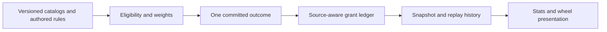

# Roda Kekacauan Framework

I built a versioned character-generation rules framework and wheel-presentation studio. I implemented weighted outcome selection, eligibility guards, source-aware grants, retained raw outcomes, deterministic replay and adapters that keep presentation separate from gameplay state.

Developed by [Vavan Farizzaman](https://github.com/VavanZaa).

## Algorithm

1. Load canonical authored catalogs and versioned rules, then compute eligible outcomes from the current stage and committed history.
2. Normalize configured positive weights and sample the actual outcome once. Conditional or fixed outcomes retain explicit identity and provenance.
3. Apply source-keyed grants and numeric modifiers through a ledger so nested routes cannot silently grant the same reward twice.
4. Preserve rolled values separately from effective modified values, and keep mastery/ownership scopes explicit.
5. Commit a versioned snapshot/history for replay before producing formatted stats or wheel-animation instructions.
6. Generate presentation assets from committed results; animation and display names do not introduce extra randomness or rewards.

## Workflow



## Run

Commands below assume a Windows terminal at the repository root unless stated otherwise.

```powershell
node --test --experimental-test-isolation=none framework/tests/*.test.mjs
node ui/build-studio.mjs
```

## Code map

`framework/`: selection, rules, grants, scoring, snapshots and tests; `content/`: required authored rule/catalog JSON; `ui/`: presentation components and studio builder; `docs/`: algorithm and design contracts.

## Scope and evidence

Probabilities, fictional power tiers and balance values are authored game rules, not empirical estimates or claims about folklore. Some catalog/body/executor profiles remain incomplete. Private episode histories, media renders, bulk mascot production files and generated movies are excluded. Preserve source notices for referenced art, fonts and textures.

This is a focused source snapshot. Installed dependencies, local environments and bulk generated research assets are rebuilt or supplied separately. See [VALIDATION.md](VALIDATION.md) for the checks performed on this export and any remaining setup requirements.

The studio builder reads small JSON fixtures under `examples/studio-fixtures/` and regenerates `preview/video-wheel-studio.html`. Shared mascot modules needed by the UI are retained. See the known catalog-count inconsistency in [VALIDATION.md](VALIDATION.md).
