# Roda Kekacauan spin algorithm

## Title256 dan gelar sekali per seri — 11 Oktober 2026

User approves contextual Title wheel and requests200++ titles, disabling each
after it is selected for a character. Read content/title-wheel-design.json
title-wheel/1.0.0, framework/title-wheel.mjs title-odds/1.0.0 and docs/TITLE-WHEEL.md.
256 canonical unique names:192 contextual/64 receh,24 bounded+1 hidden recipes.
Normally curate12 matching contextual+4 receh, then uniform16 at6.25% each.
Actual committed race/subtype/role/Backstory/normal Size, immutable main results,
registered pre-Title provisional modifiers, active owned weapon/power/weakness
and completed Chaos result build tags. No future Title/Enchant evidence.
Unknown affinities remain neutral; hard literal conditions keep false titles out.
Equalizer suppresses soft shortlist scores, retains hard guards/count structure.
Titles are lore by default; names never grant unlisted powers/equipment/ranks.

state/title-usage.json is explicit persistent series roda-kekacauan-main, empty
initially. One canonical title per [runId,characterId]; claim disables it for
all later characters/runs in this series. Atomic lock+plan+draw+claim+receipt
helper in framework/title-store.mjs; stale external pools/corrupt state fail.
Resume returns saved result without RNG/extra consumed title/duplicate effects.
Never auto-reset, reenable used titles or fill shortages with ineligible names.
Smaller eligible shortlist is allowed; none means exhausted-for-context.
24 hidden effects:20 main-stat+1,2 one-weapon mastery+1,2 shared power mastery+1.
Uniform existing weapon target when required; numeric modifiers final-only,
ordinary final Master5/compatible-unused-slot Enchant gate, no power Enchant.
Actual funny Title draws retain existing source-once Shrek hook; preview/replay/
singleton fixed reveal does not create a funny raw spin. Source receipts persist
before hidden children; character-journal transaction/scheduler/media integration
remain future. Preserve original raw/Lucky/Pawn/guarantee evidence.

preview/title-roster.html contains256 searchable labels/seven examples and
browser-local DEMO disabled IDs only. It uses the same shortlist function,
anticlockwise animation and separate reset; never touches production usage.
Static JS/data/rotation and scoped persistent/concurrent tests verified; no
browser visual inspection claimed. Preserve reference/before-title-wheel-
2026-10-11.json and all earlier recovery files. This supersedes Title-not-started
notes; remaining Chaos/Chaotic Power/full executor are still separate.

## Mekanisme lanjutan12 Divine — 11 Oktober 2026

User asks follow-up mechanisms for every preceding Divine effect. Read
content/divine-followup-design.json divine-followups/1.0.0 and
docs/DIVINE-EVENTS.md; chaos-wheel/0.4.0 links all12 flows. These are complete
editable algorithm designs, not an implemented persistent/video/combat executor.
Keep root15/12/8 per side +30 None, original Chaos12 and inactive optional methods.
Uniform live target selection; singleton reveal without RNG; absent targets
filter the child event only; unknown proofs are configuration, not absence.
Small Blessing chooses one stat; Targeted picks derived pre-bonus lowest/ties;
Double Blessing draws5 then4 distinct stats. Expert picks one owned active
weapon and queues+1 for final ordinary Enchant gate. Resonance is one shared+1.
Purification picks one active canonical receh weakness; preserve audit/source
packages. Low conditional traits have one atomic qualifying-action charge,
no permanent power or always-on stat bonus. Restoration selects uncompensated
negative source/stat entries, refunds<=2 once, preserving original negatives.

Second Chance selects original actual nonguaranteed raw<9 minimum/ties; copy/
fixed outcomes excluded. New ordinary/High Roller attempts use current stat
odds, Resilient<=5 one retry. For Double/Nothing resolve one new50:50 decision
then refund min(2,max(0,newBase-oldBase)); this refines prior raw-only shorthand.
Original base/roll history never replaced. All In has only actual Strength
eligible and Strength-only additive reward; four copied bases remain. Actual
late attempts keep Lucky/Pawn source hooks; targets/fixed/replay never fabricate
raw hits. Gift draws universal Divine Tier1..3 unowned leaves (12 initially),
reuses shared mastery; first late power gets one ordinary gate, God fixed9 skip.

All numeric effects remain final-only, signed/unbounded; charge traits separate.
Finish actual children/reactions then saved Title return; do not advance wheel
design automatically. Stable step receipts compare live proof/ledger before
atomic commit, replay does not duplicate RNG/effects/charges. Preserve
reference/before-divine-followups-2026-10-11.json and all earlier snapshots.
This note supersedes older missing Divine follow-up/late-combination designs;
runtime adapters, Chaos roster/scopes and Title remain future.

## Divine12 dengan hadiah lebih kecil — 11 Oktober 2026

Latest user requests FOUR Divine effects per Low/Medium/High, toned down
because it has little risk, and suggestions for fun odds/methods. Read
content/chaos-wheel-design.json chaos-wheel/0.3.0 and docs/CHAOS-WHEEL.md.
Divine12 authored editable recipes; original Chaos12 unchanged,24 total/four
per six branches. Root15/12/8 per side +30 None stays exactly confirmed.
Default four child choices25% each before compatible-target filters/Equalizer;
child curation/owned guards never recompute root group masses.

Low: one main-stat point or one-point single-use conditional Durability/Speed/
Fight trait. Medium: one targeted stat, one Weapon Mastery on one owned weapon,
one shared Power Mastery, or disable one main40 receh weakness. High: +1 two
distinct stats, capped positive reroll bonus<=2, one Divine Power Tier1..3,
or refund<=2 existing negative main-stat points. Old +1 all-five, unlimited
reroll jump and unfiltered20 Divine Gift proposals are replaced for this
caller. Global Divine20/302 power tiers remain unchanged. Caps are only source
reward budgets, never total-stat caps; signed/unbounded final scores, original
raw evidence, actual Lucky/Resilient/Pawn hooks/shared mastery remain. Conditional
one-use stats are traits, not permanent powers or final-card flat stats. Weapon
+1 may open the existing final compatible Master5+ Enchant gate.

Optional suggestions are NOT active: pity after3 persisted main-root None in
one explicit series (next root excludes None, retained weights normalize over70;
Equalizer then1/6), and reveal fixed Chaos cost before unknown reward. No fake
cost spin/early stat settlement. Persistent counters/runtime and exact late
reroll/combat adapters remain future. No new Chaotic Power definitions or Title
advance. Preserve reference/before-divine-rebalance-2026-10-11.json and prior
snapshots/frozen plans. This note supersedes older Divine4 reward packages.

## Roda Kekacauan tujuh hasil dan peluang — 11 Oktober 2026

Latest user correction confirms BOTH Chaos and Divine have Low/Medium/High.
Read content/chaos-wheel-design.json chaos-wheel/0.2.0. One opening wheel:
Chaos Low15/Medium12/High8%, Divine Low15/Medium12/High8%, None30%.
Weights15:12:8:15:12:8:30 total100; side totals35/35/30. No separate side/
severity draw, equal-root default or child-count mass multiplication. Active
Equalizer uniformly overrides eligible root leaves after guards (seven1/7).
Numeric-stat/mastery5%..25% bounds do not apply. None commits one actual result/
reaction and returns Title, preserving all prior facts/grants/modifiers; no
effect child or generic boost. Preserve old frozen four-root draft/recovery.

Sixteen prior event candidates remain PROPOSED and unexecuted. Divine split
is authored proposal: Purification Low; Gift/Second Chance Medium; all-five
Blessing High. Do not treat grouping correction as approval of every reward.
No new effect candidates or powers invented. Inversion scope/order and shared
Chaotic Power roster/tiers still need review. Backstory0.6.2 metadata notes
prior None/non-None intents are meaningful again but numeric odds stay pending.
Signed final-only bonuses/raw evidence/shared mastery/final Enchant unchanged.
No runtime executor introduced. No automatic advance to Title.

Preserve reference/before-chaos-seven-outcomes-2026-10-11.json and prior
reference/before-chaos-proposal-2026-10-11.json. This note supersedes older
four-root/25%-each/None-removal recommendations below.

## Roda Kekacauan menggantikan Apex Force — 11 Oktober 2026

User renames Apex Force to Roda Kekacauan, matching project branding. Read
content/chaos-wheel-design.json chaos-wheel/0.1.0 and docs/CHAOS-WHEEL.md.
Display rename is confirmed; internal stage/odds target apex and historical
apexForce aliases remain for saved compatibility. New Chaos Low/Medium/High
and Divine structure plus sixteen event candidates are PROPOSALS, not approved
active recipes. User supplies Inversion7->2/9->0 and Pact-1 main stats plus
one Chaotic Power spin. Inversion target scope is awaiting user answer.

Propose four equal root leaves and four equal effect leaves per branch, with
hard target guards then Equalizer. Root topology/None removal and operation
order are still reviewable. Retire old generic No-Apex/always-extra-boost
template for new-design review; never execute two Apex/Chaos stages. No runtime
helper or automatic event activation. Signed/unbounded final-only bonuses,
immutable raw/Lucky/Pawn evidence, shared Power Mastery and final Enchant
gates remain. Proposed new power-chaotic is separate/universal with roster and
canonical Tier scopes pending; it is not a silent Demonic/Cursed alias.

Backstory0.6.1 changes display text only and notes two old Apex/None intentions
need semantic remap. No numeric odds/event recipes/grants changed. Preserve
historical frozen plans and reference/before-chaos-proposal-2026-10-11.json.
Next review Chaos effects with user; do not auto-advance to Title.

## Weakness40 dan Human50% — 11 Oktober 2026

Read content/weakness-wheel-design.json weakness-wheel/1.0.0 and
framework/weakness-wheel.mjs weakness-odds/1.0.0. Forty authored editable
recipes plus None. User confirms Human50% Weakness/50% None and then replaces
Buta/Silau Berat with Mata Silinder. Normal sole-Human physical ancestry,
including transparent host/size/origin wrappers, has50% None; forty ordinary
leaves1.25% each before four approved gentle Backstory factors. Non-Human None
is not invented as50%: use equal compatible eligible leaves until explicit
race priors are configured. Human capability profile is explicit; non-Human
body traits need committed owner-proof adapter. Unknown body means configuration.
Equalizer flattens all eligible leaves including None after guards; no stat
5%/25% bounds or weapon/power tier quotas on Weakness.

Only Stamina Cepat Habis registers final-only Speed-1. Others are conditional
combat restrictions or lore. No automatic severity/activation/countermeasure
wheel, always-on penalty, numeric mastery/power grant or Enchant. Power-related
limits stay dormant without an owned power. Health/vision contexts are neutral
game conditions; no diagnosis or degrading audience-focused punchline. None
preserves earlier Cursed/Rage/Overload/etc; independent repeated draws merge
canonical definition/provenance without multiplying its penalty. Actual tagged
funny draws supply existing Shrek source-once hook; replay/fixed grants do not.

Backstory0.6 binds four approved Weakness intents (quiet-life, betrayed,
appeared-one-day, unsealed), and Test Subject extra immediate weakness uses
this same wheel before Size with saved Backstory return. Main Weakness after
Power still happens. Early planner uses only completed owner race/role sources,
no future Size/stat/Power data. Extra retains None unless guaranteed explicitly.
Pure planner/external CDF/resolver freeze source/odds/recipes, compare ownership
and emit source-once atomic receipts. Persistent store/combat/body/media/video
adapters remain future. No automatic advance to Apex/Title.

Regenerate preview: node framework/scripts/weakness-preview.mjs.
Preview has all40 editable entries, Human/Equalizer/four Backstory examples,
anticlockwise motion and explicit conditions/effects. Grouping is display only,
not a hidden category spin or new rarity. Static JS/odds/rotation checked;
browser visual QA is not claimed. Preserve reference/before-weakness-wheel-
2026-10-11.json plus all older recovery files/frozen journals.

## Power utama 160 dan peluang karakter — 10 Oktober 2026

User explicitly asks to finish previously planned main Power. Read
content/main-power-wheel-design.json main-power-wheel/1.0.0 and
framework/power-wheel.mjs power-odds/1.0.0. Main160 curated ordinary powers,
32 per intrinsic Tier1..5, plus None:158 existing canonical references and2
new Water Breathing1/Time Stop5 definitions. Power registry now302 with all
original300 ratings/policy unchanged. Authentic baseline fixture:
reference/power-tier-before-main-160.json. Creation reuses Primordial canonical
definition but never dispatches Primordial/Royal/Anime/source reward packages.

Authored editable odds use344 body/subrace fallback/routes,6 wrapper profiles,
27 archetypes,6 actual role-result rules,32 actual element/concept affinities
and16 approved Backstory bindings. Intrinsic-tier center is separate from
mastery or the weapon audit. Gaussian likelihood plus20% lucky uniform tail,
gentle tag factors max2, explicit Backstory tier factors, bounded normal-form
physical Size response max0.25; no transformation/external body/caption/final
bonus evidence. Body composition uses actual host/base/origin once. Household
low center/70% None keeps it usually weak; Anime genre/role and Fey seasons
have actual-source priors. Human50% None is an authored adjustable default,
not a submitted answer to the earlier optional question. All powers remain
possible unless hard exclusions/ownership remove them. No main Power reserved
equal tier masses, stat/mastery5% floor or25% cap. Existing numeric-stat engine
calibration stays unchanged; three owner-context tables append currently
canonical thematic outcome IDs without removing old IDs or granting access.

Actual God/full VesselGod90..100 non-guaranteed normal acquisition80% None.
Mage ordinary2/Master3 total includes main, each guaranteed. Master Sihir
exact x3 Tier3..5 weights applies only to Mage-managed requests. Hard guarantees
remove None first; Equalizer subsequently flattens eligible leaves, suppressing
soft lore/God scarcity/Mage weights without changing counts/ownership/guards.
Incompatible Archetype pairs still fail the accepted composition contract.

Stage helper creates stable ordered main/Mage/Fairy King/Shaman/Lich/Anime
FantasyMC/Backstory requests. Dumpster remains one guaranteed deferred extra;
other source normal-pool extras can get None. Freeze only the NEXT actual pool
after grant/None/reaction and refreshed ownership; consume each source request
once. Canonical ref/file/ordinary mode dedup; current None preserves earlier
powers. Fixed identical mode AND bounded binding merges provenance, not donor
mastery/Authority overrides. Unknown refs require migration. Eight universal
themes remain separate/equal and now have a source-caller pure planner with
ownership exclusion, one ordinary selected grant and exact saved return.
Exhaustion is needs_configuration preserving state; no new fallback/reroll/
duplicate reward or skipped required ticket. Earlier optional Power question
does not remain a blocker; the latest finish instruction delegates completion.

After all acquisitions, exactly one shared mastery gate: empty skips, actual
God/qualified Vessel fixed9 skips RNG, ordinary settled raw base reused by late
powers; final signed/unbounded modifiers and Resilient preserved. No Power
Enchant. Pure planners/CDF/resolvers emit guarded source-once receipts; caller
must atomically persist grant/None/request ledger before another pool. Persistent
scheduler/atomic store, combat/body/output limits and image/video adapters are
still future; this completes wheel DESIGN and its scoped helpers.

Regenerate: node framework/scripts/power-coverage.mjs
and node framework/scripts/power-preview.mjs
Coverage records455 actor contexts. Offline preview power-roster.html has160
searchable powers,23 frozen conditional examples, owned-power toggles and
weighted anticlockwise example spins. Search/Tier filters change only display.
Static JS/data/weighted rotation math and ownership normalization verified;
browser visual QA is not claimed. Preserve reference/before-main-power-wheel-
2026-10-10.json plus all prior recovery files. No automatic Weakness advance.

## 60 Enchantment dan gate akhir — 10 Oktober 2026

Latest user corrects next-wheel order: design Enchantment before Power. Read
content/enchantment-wheel-design.json and framework/enchantment-wheel.mjs,
enchantment-wheel/1.0.0. Sixty editable recipes, twelve per authored intrinsic
strength Tier1..5: zonk/practical/combat/special/legendary. All eligible leaves
have equal base probability; no None or separate rarity/tier selector. Weapon
equal-tier masses and stat/mastery5% floor/25% cap do not apply to Enchant.
Includes Ukuran Raksasa, Bloodsteal, Api, Living Weapon, Tajam, Super Kecil,
Licin and thirteen explicitly tagged funny results. Names/effect limits and
tier ordering are authored game choices, not external canon facts.

Preserve accepted timing: only final bonus phase after Title/late events and
all required raw/mastery/retry draws. Active owned enchantable weapon plus
final effective Weapon Mastery>=Master5 and one unused compatible slot permit
one draw. Retained raw0..9 plus distinct matching signed modifiers, no final
clamp; raw4+1 qualifies and raw5-1 does not. Existing proposed one-slot default
is retained, not multiplied by mastery. Canonical compatibility bindings cover
all150 main weapon definitions and reused early definitions with the same exact
reference. Sharp needs an edge; Ricochet a projectile; Battery Leak powered
capability. Unknown early weapons, girlfriend companions and external platforms
need explicit adapter bindings; never infer artifact compatibility from labels.
This is enchant compatibility, not owner anatomical body-fit validation.

Traits stay on the selected weapon instance. No direct main-stat/mastery bonus,
owner power, extra weapon/race/event or Power Enchant. Size enchants leave owner
Size unchanged. Bloodsteal needs a wounding hit on a blood-bearing target and
heals minor wounds, never invokes Vampire rewards. Living Weapon remains one
instance with bounded autonomous behavior. An actual tagged funny Enchant spin
supplies the existing source-once Shrek hook, settled by the ordinary final stat
ledger. Projection/replay/preview are not new funny results.

Pure planner/selector/resolver freeze canonical capability and final-mastery
proof, normalized eligible leaves and recipes before external RNG. Stable slot
key is [runId,characterId,weaponInstanceId,enchant,0]; caller must atomically
compare snapshot/active-inventory guard, attach trait and consume slot. Consumed
slots skip even after mastery changes; untyped legacy records need migration.
No persistent executor, atomic store or weapon-attack/render adapter is claimed.

Regenerate searchable offline preview with:
node framework/scripts/enchantment-preview.mjs
preview/enchantment-roster.html includes all60 recipes and150 compatible weapon
pools. Its example spin is presentation-only. Motion is anticlockwise; clockwise
ascending sector placement gives weak-to-strong passage under the pointer.
Search/Tier filters change the list, never the spin pool. Static data/JS and
rotation math checked; no browser visual inspection claimed. Preserve
reference/before-enchantment-wheel-2026-10-10.json and all earlier snapshots.
No automatic advance to Power/Weakness. The earlier optional Human Power None
question is pending for future Power design; no answer/default is committed.

## Weapon affinity dan audit seluruh subras — 10 Oktober 2026

Latest user asks gentle race/role-conditioned weapon affinity and a thorough
weapon-reliance audit, with Ultraman as an innate-power example. Read
content/weapon-wheel-design.json weapon-wheel/0.2.0 and
framework/weapon-wheel.mjs weapon-odds/0.2.0. All324 current terminal identity
routes across22 memberships are explicitly reviewed, including110 active hero
references, all Machine models/appliances and nested Elf/Beast/Lelembut/Cosmic
branches, plus131 armor/color/cheat/external-pilot event contexts.344 physical
profiles include19 family fallbacks; six behavioral
wrapper profiles inherit actual host/base/origin. Review record and generation:
reference/weapon-race-affinity-audit.json and
node framework/scripts/weapon-affinity-audit.mjs. Every numerical rate is an
editable authored game prior, not empirical canon ownership data. Existing
accepted recipes/research inform the audit; selected official Ultraman/Trigger
sources support body-beam combat plus a possible weapon exception.

Ordinary matching item factors are1..1.6 per profile, maximum matching tag once,
and combined ordinary weight is capped at2. Distinct sword/dagger/polearm/bow/
fist/flexible styles avoid treating every blade as a sword. Actual Royal
royal-chess-piece=knight favors swords1.5, shield1.3 and polearm1.2; Pawn and
unspecified Royal do not inherit Knight affinity. All150 recipes remain eligible
unless an explicit hard rule excludes them. Buku Jari Besi has Brass Knuckle
search aliases; Nunchaku remains Tier3 with flexible-weapon tagging.

None is separate: each Tier1..5 still receives20% of non-None mass. Example
baselines: Human20% None, Dragon80%, Ultraman90%, Phoenix95%, Slime80%,
Android75%, Cyborg45%, AI/appliance95%; Oni/Atlantean/Kinnara/Arthur10%.
Siluman is the approved humanoid normal form, so20%, not a full-animal prior;
Centaur retains humanoid upper-torso weapon use10%. Body/power-led beings are
more likely to skip ADDITIONAL acquisition; None removes no existing weapon,
power, ring/armor/board, or authorized extra spin and grants no stat buff.
Do not convert these soft priors into anatomical capability bans.

Physical host/body profiles compose once using the existing minimum/mean
mixture; actual wrappers add one most-specific behavioral overlay per source.
Giant/Skeleton inherit the base/origin propensity unchanged; Zombie adds3x
None odds, Symbiote80..100 adds1.8x None odds, never flat percentage points.
Hybrid combines actual body sources, not its label. External prey/armies/
companions/mentor/mecha, future results, narration, transformation sizes and
final bonus ledgers are not owner acquisition evidence. Six approved Backstory
bindings remain, with reduced ordinary affinity strength. The prior explicit
Paladin Sacred Sword reservation55% of Tier4 is retained as the named exception
(typical Human Paladin about10.1% overall); no Tier mass increase. Equalizer
still flattens every eligible leaf including None and suppresses all affinities.
Gladiator actual lock and guaranteed extras keep their established precedence.
Saint armor overrides: Libra20% None/sword-polearm-flexible preference,
Sagittarius20%/bow, Andromeda30%/flexible, Lyra25%/musical, Perseus35%/shield,
Auriga40%/ranged, Chameleon40%/flexible; other Saints80% unless another actual
source applies. These are authored affinities, not extra canon weapon grants.

New plans use0.2. Real frozen0.1 recipe/odds replay is supported and tested using
reference/weapon-odds-legacy-0.1-fixture.json; never replan saved draws. Weapon
Tier is independent of mastery; final-only bonuses and effective-Master5+
compatible Enchant remain. Pure planner/resolver and offline searchable
preview have27 actual conditional examples plus455-row race/event audit. Regenerate
with node framework/scripts/weapon-preview.mjs after regenerating the audit.
Persistent executor, capability/body fit and video adapters remain future.
Preserve reference/before-weapon-affinity-audit-2026-10-10.json and the earlier
before-weapon-wheel snapshot. This latest note supersedes the older broad
family/strong-affinity defaults below. No next-wheel auto-advance.

## Weapon roster and equal tiers — 10 Oktober 2026

Latest user delegates150 mixed funny/ordinary/legendary weapons and owner
Race/Archetype/Backstory-conditioned odds, then explicitly makes all five Tier
probabilities equal. Read content/weapon-wheel-design.json weapon-wheel/0.1.0
and framework/weapon-wheel.mjs weapon-odds/0.1.0. One flat151-sector main wheel:
150 weapons/30 per Tier, plus None. None is outside tiers. After species/subtype
None propensity, each Tier gets20% of remaining weapon mass. Lore changes item
weights only within each Tier; maximum matching tag factor per profile avoids
counting overlapping blade/holy/magic tags several times. Authored calibration,
not canon/statistical power scale. Human baseline None20%/eachTier16%; Western
Dragon None80%/eachTier4%. Human Paladin Sacred Sword about10.1% overall via55%
reservation within Tier4; a different None propensity changes this percentage.
Never boost Tier4 mass. Composite hosts/bodies choose actual physical priors;
wrappers are not independent anatomy. Six approved Backstory weapon intents are
now bound; Power/Weakness/Apex/Title bindings remain pending.

Hard exclusions and guaranteed extra None exclusion precede odds. Equalizer
flattens every eligible individual sector including None and suppresses lore/
anchors; after unequal item exclusions this named override can supersede equal
tier masses. An entirely excluded tier needs_configuration. Actual committed
Gladiator lock skips acquisition before RNG; normal None erases no early weapon.
Reused Katana/Trishula/Tech/Excalibur/Durandal definitions do not dispatch their
source race/hero events or inherit source-only mastery boosts. Separate sources
remain distinct weapon instances; no new weapon no-repeat rule. Intrinsic Tier
never sets Weapon Mastery0..9, adds a power/stat, or guarantees Enchant. Preserve
final-only bonuses, per-active-instance raw mastery, final effective5+ compatible
Enchant, source-once actual funny-result/Shrek hooks, and old frozen histories.
Pure helper emits source-keyed grant/None then returns weapon-subflow for all
queued bonus acquisitions/details/masteries before Power; not persistent
execution. Capability limits/body fit/Enchant adapters/video remain future.
The roster preview is generated from these actual frozen example plans.
Preserve reference/before-weapon-wheel-2026-10-10.json. Do not auto-advance Power.


## Backstory approved and event timing — 10 Oktober 2026

All38 proposed Backstory recipes and qualitative odds intents are user-approved.
Read content/backstory-wheel-design.json backstory/0.4.0 and framework/backstory-event.mjs.
General Power extras register source-owned tickets now and spin at the Power
stage; Dumpster gives one guaranteed acquisition excluding None with a future
Tier1–2 preference. Android/Divine wheels and Test Subject extra Weakness run
immediately; fixed Intangibility grants immediately. Finish those children and
reactions before Size. Normal later Weakness/main Power stages remain. Numeric
stat/mastery modifiers register immediately but calculate final-only. No early
mastery/Enchant. Early powers survive main None; God shared9 remains no-RNG.
Five separately authored editable0.35 lore shifts favor current stats/masteries
under stat-odds/0.4.0 (96 event rules); not measured data or numeric user choice.
Other qualitative odds are approved intents awaiting future pool/tag bindings;
no caption-derived multiplier. Pure helper freezes recipes and emits queues/
unique source keys; persistent scheduler/adapters still future. Design ready,
production wheel remains disabled until its required adapters exist. Source38
equal base/labels/IDs and old saved histories preserved. Latest approval
supersedes one-at-a-time/pending37 notes below. Preserve recovery snapshot
reference/before-backstory-approval-timing-2026-10-10.json.


Backstory helper: call `planBackstoryWheel` with stable `runId`, `characterId`,
`invocationId` and `raceAndArchetypeComplete:true` only after upstream queues
finish. Save the returned plan, then pass one external sample to
`selectBackstoryOutcome`. Save actual `runId`, `characterId`, `invocationId`,
`spinId`, `outcomeId`; `resolveBackstoryResult` reads that frozen recipe and emits
`backstoryFact`, source-keyed registrations, immediate requests and deferred
Power tickets. It never samples child wheels, mutates stats, invents a future
result or consumes a queue. The persistent caller must commit once, await the
normal reaction and all immediate children/reactions, then restore Size. The
Test Subject Weakness request remains mandatory while its future catalog/adapter
is missing. Freeze each later acquisition pool only at its actual invocation,
after owned-power exclusions and Equalizer. Keep frozen older journals intact.


## Jaminan maksimum dan awal review Backstory — 10 Oktober 2026

User explicitly confirms God skips ALL Power Mastery and all owned powers use
base9. New stat-odds/0.3.0 checks committed God/qualified VesselGod60..100
guarantee before RNG; fixed shared9 across present/future powers. General
maximum-skip rule also fixes Lich Durability9 without singleton spin. No actual
attempt/spin ID/Lucky hit/Resilient retry/Double decision/Pawn sampled category.
Hard exclusion of9 requires configuration; empty power inventory stays empty.
Bonuses/debuffs final-only signed/unbounded. Ordinary5%..25%, Kinnara minimum,
all acquisitions/follower/scarcity/counts/old saved histories remain. Latest
shared guarantee supersedes older source-instance-only Authority wording.
Backstory0.3: video2 roster38, Orang random approved lore-only/no effects or
followup. No implicit numeric odds;37 outcomes pending, next made-in-lab.
Latest user asks effect suggestions for all38 Backstories together; proposals saved separately, only Orang random approved. Full persistent/video executor remains future. Preserve
reference/before-guarantee-skip-backstory-2026-10-10.json.


Keputusan terbaru — 10 Oktober2026: [stat/mastery engine](STAT-SCALES.md)
memakai170 prior ras,28 profil role dan91 likelihood event. Lima stat, tiap
weapon mastery dan satu shared power mastery mempunyai odds berbeda, minimum5% dan maksimum
25% per actual hasil acak yang masih eligible. Lich rawDurability9 tetap jaminan100%; Equalizer
uniform setelah guard. Parameter lore bukan bonus akhir. Size hanya bentuk
utama; transformasi tidak membutuhkan Size tambahan. Planner/raw resolver
tersedia, persistent scheduler/video belum dibuat.

Size sekarang memakai **model peluang kontekstual yang bisa disetel**: gabungkan prior ras, update dari event/Archetype dan interaksi, lalu bentuk roda angka bulat. Simpan model/posterior sebelum spin. Parameter awal masih desain editable, belum dikalibrasi empiris. Lihat [Size](SIZE-RAKSASA-EVENTS.md).

Size kini memakai fungsi rentang ras/subras + Archetype dengan angka bulat, langkah linear/eksponensial dan satu profil tubuh campuran; Raksasa memakai delapan milestone abnormal. Contoh pengguna: Tuyul60–120cm, Ultraman50–70m. Lihat [Size](SIZE-RAKSASA-EVENTS.md). Coverage profil lainnya dan review event Backstory masih berlangsung.

## Current Race/Archetype refinements — 10 October2026

Main wheels spin anticlockwise; clockwise ascending sectors pass the top pointer weakest-to-strongest. Canonical IDs/outcomes/odds are unchanged. All seven final numeric scores are signed/unbounded, raw0..9 remains immutable. Lich rawDurability9 may fall after debuffs. Authorized God/Vessel Authority uses base9 plus shared final mastery modifiers. Acquisition excludes owned powers before draw; identical fixed grants merge provenance. AI may mix Hybrid/Mutant committed bodies into one frozen validated blueprint. Hybrid role conflicts are filtered before child2. Valid empty Disciple archive gives one ordinary Divine lesson from God. See [detail decisions](DECISIONS.md), [shared mastery](POWER-MASTERY.md), [Hybrid pairs](ARCHETYPE-HYBRID-EVENTS.md), [Disciple](DISCIPLE-EVENTS.md). These policies supersede older pending/cap wording; future wheel catalogs/executors remain separate work.

The character develops through a fixed main sequence with conditional event branches. Each result
updates shared character state, changes later relevant odds, and receives a narrated meme reaction.
Content entries define the names and exact branches; the algorithm handles every entry consistently.

Active [Equalizer](EQUALIZER-EVENTS.md) overrides final probabilities on every
subsequent actual mechanics wheel after structural eligibility. Use 1/N per
canonical allowed option, ignoring ordinary ratios/shapes/lore weights;
normal odds below apply when no Equalizer source is active.

## Main sequence

```mermaid
flowchart TD
    A[Select comment or direct requester] --> B[Race]
    B --> BE[Resolve race events]
    BE --> AC{Archetype eligibility gate}
    AC -- Spin --> C[One compatible Archetype]
    AC -- Skip --> D[Backstory]
    AC -- Missing profile --> CFG[Configuration required]
    C --> CE[Resolve approved archetype events]
    CE --> D
    D --> DE[Resolve backstory events]
    DE --> SZ[Size and size events]
    SZ --> CG{Larger than planet and Cosmic reward unused?}
    CG -- Yes --> CP[Universal Cosmic Power spin]
    CG -- No --> S[Strength]
    CP --> S
    S --> SP[Speed]
    SP --> DU[Durability]
    DU --> IQ[Intelligence]
    IQ --> F[Fight]
    F --> W[Weapon acquisition, events, and queued bonus spins]
    W --> WG{Any owned weapons?}
    WG -- No --> P[Power acquisition, events, and queued bonus spins]
    WG -- Yes --> WM[Raw Weapon Mastery and optional Resilient retry]
    WM --> P
    P --> PG{Any owned powers?}
    PG -- No --> WK[Weakness and events]
    PG -- Yes --> PM[Shared raw Power Mastery and optional Resilient retry]
    PM --> WK
    WK --> AX[Roda Kekacauan — review]
    AX --> CN{None 30 percent?}
    CN -- Yes --> T[Title]
    CN -- No --> CE[Chaos or Divine Low 15, Medium 12, High 8 percent per side]
    CE --> CK[Selected event and required children - recipes under review]
    CK --> T
    T --> TG{Hidden event triggered?}
    TG -- No --> Z[Final bonus phase]
    TG -- Yes --> TE[Resolve hidden wheels and new grants]
    TE --> Z
    Z --> BM[Calculate Weapon and Power Mastery bonuses]
    BM --> EG{Effective Weapon Mastery at least Master and compatible unused slot?}
    EG -- Yes --> E[Enchant spin and approved events]
    E --> ED[Drain late events and refresh changed mastery sources]
    ED --> BM
    EG -- No pending slot --> FS[Settle Lucky Number and all main-stat bonuses]
    FS --> I[Generate and reveal character image]
    I --> FC[Show final stats]
```



Every wheel in this diagram includes a result reveal, narrator commentary, meme clip, and caption.
Each of the five main stats has its own spin and reaction. Fight means combat skill and technique
in the proposed design; physical strength and supernatural power remain separate.

Final stats are calculated internally before generating the image. The audience sees the image
first, then the stat card, as requested.

## Procedure after every spin

```text
Current character state
  → Select the active wheel and eligible outcomes
  → Calculate and freeze this spin's probabilities
  → Spin once and record the result
  → Atomically commit grants, modifier source ledgers and deterministic hooks (including source-owned Shrek bonuses; all main-stat/mastery bonuses calculate only in final bonus phase)
  → Consume any used stage ticket or hook key once
  → Record its factual context layer and freeze this spin's narrator view
  → Narrator reaction, meme clip, and caption
  → Check event and unlock conditions
      ├─ No event: continue
      └─ Event: run its wheel through this same procedure
                 └─ Finish its child events, then return
```

Immediate events finish before the next main stage begins. If several events trigger, explicit
priority and stable IDs determine their order. An event remembers where to return, so a new power
granted by a title inherits the shared mastery result; if the earlier stage was empty, it invokes the first/only draw, then returns to finalization.

The program records the entire mechanical sequence before producing media. The video timeline
then presents each recorded spin and its reaction in order.

## Branch structure

These are reusable branch templates. A catalog entry chooses the branches that belong to it;
the system does not run every template for every result.

### Race events

Human is confirmed to have no race-specific event or extra selector. Record the ordinary
Human result, react with the context "Nggak ada yang spesial, cuma manusia biasa", then
continue directly to the main archetype spin. Other race events follow their declared rules.

Elf opens the confirmed Type of Elf wheel with eight types and their defined profiles. High Elf
draws one Holy Power, Dark Elf one Cursed Power, and Blood Elf one Blood Power, each from a
12-option pool ordered by relative potential. Forest, Shadow, and Astral Elf receive Forest
Control, Shadow Manipulation, and Astral Projection respectively, without another subtype wheel.
Sea Elf draws Putri Duyung at 60% for Mermaid Song, or Atlantean Warrior at 40% for Trishula and
+1 numeric Strength point. Fey Elf draws Summer/Fire, Autumn/Decay, Winter/Ice, or Spring/Life.
All grants add context and remain in the character's owned collections with mastery unresolved
until its normal stage. Complete entries and per-result contexts are in [Elf events](ELF-EVENTS.md).
Type/power/season base weights are equal by the user default; numerical balance remains pending. Sea form odds are fixed.

Kurcaci selects Dwarf or Gnome. Dwarf spins an armor count from one to five, then performs exactly
that many unique armor-piece spins without replacement. The count weights are interpreted as
5:4:3:2:1 from the user's `5:4:3:2:!`; the interpretation was disclosed. Helmet, Body Armor, and
Leggings each grant +1 Durability, Gloves +1 Fight, and Boots +1 Speed as numeric-point modifiers.
Record armor in its own collection, with one linked effect per committed piece result.

Before every armor draw, remove chosen pieces, normalize remaining weights, and disable their
sectors in the active wheel. Uniform eligible-piece base weights are now user-confirmed. Five awarded
pieces require five actual spins, including the final one-option 100% spin and its reaction.
Gnome spins one of twenty tinker gadgets and retains it for the normal Weapon
Mastery stage. No personal power or extra stat bonus is inferred from device effects.
The gadget pool uses clockwork, gears, steam, springs, lenses, alchemical sprays, traps, and decoys.
Direct attack, control, and tactical deception gadgets all count as one weapon kit under this rule.
See [Dwarf/Gnome events](DWARF-GNOME-EVENTS.md) for all choices and narration contexts.

Goblin & Orc selects Goblin, Orc, or Troll. Goblin spins army count with weights 5:10:15:10:5:1
for 0/5/20/100/1000/10000, then Bos/Kacung 1:1 even at zero. Store unit size separately from
command: Kacung controls zero, while Bos controls the rolled count. General shares this army
selector as the documented working interpretation; army count grants no personal stat bonus.

Orc roles General/Oni/Warrior/Shaman/Shrek have fixed weights 1:2:3:3:1. Oni receives Katana
and one draw from the existing Cursed Power pool, preserving its Oni caller provenance and
return point. Warrior queues one bonus Weapon acquisition for an extra weapon; Shaman queues
one bonus Power acquisition. These tickets wait for their normal stages and do not determine
results in advance. Shrek receives its power and a committed-outcome growth hook. Every later
catalog-tagged funny-result spin adds +1 numeric point to each of the five stats. Acquisition
gives zero points; repeated evaluation or media retries never count as new funny results.

Troll spins one of twelve game conditions, each with one mapped -1 point effect; the normal
Weakness stage remains. Complete outcomes, ratios, per-result context, and design interpretations
are in [Goblin/Orc/Troll events](GOBLIN-ORC-TROLL-EVENTS.md).

Raksasa binds the giant variant at the global Size stage and skips Archetype under accepted
policy 1.0.0. Complete its base/nested race events, record zero-spin skip, then Backstory/events.
All characters spin Size before Strength. Ordinary Size resolves a race/subrace+Archetype/body
range, generates twelve linear or exponential positions, rounds whole display-unit values and
merges duplicates. Broad normal odds are separate from option spacing; Equalizer makes eligible
outcomes uniform. Raksasa uses the eight specified 10 m through Sun Size milestones, each with
equal 1/8 probability. Profile ranges and normal width/center are editable design tuning.
The range function, sources, profile estimates and distributions are in
[Size and Raksasa events](SIZE-RAKSASA-EVENTS.md).

Size strictly larger than Earth diameter grants one universal Cosmic Power, which reacts before
main stats and stays owned for normal Power Mastery. Planet equality does not qualify. All
Holy/Cursed/Blood/Cosmic/Symbiote calls use the same canonical themed wheels and actual caller provenance;
see [universal Power wheels](UNIVERSAL-POWER-WHEELS.md).

Peri selects Parents/Pixie/Healer/King with fixed 4:2:3:1 odds. Parents/Healer grant one
Wish/Healing power respectively. Pixie draws the canonical universal Element selector and
receives one linked manipulation power; its four-element roster remains proposed, with equal default base weights.
King queues one extra Power acquisition and +2 mastery for every owned power, as confirmed by
the user. Record one shared base/effective Power Mastery rank, apply each source bonus once, and
remain signed and unbounded without a reroll. The [Fairy guide](FAIRY-EVENTS.md) defines
all result contexts. All Fairy types keep the global Size phase; source profiles are pending.

The working design selects one of eighteen race/theme families using familiar mixed
Indonesian/English labels. Lelembut selects Lokal/Impor and then creature type. Mythical Beast
contains ten user-confirmed local types/events and eight imported candidates. Barong Bali and
Reog Jawa are separate primary local types. Reog visual context includes the user-specified
wide face and the tiger-head/peacock-feather reference. Fixed type grants/modifiers apply at
the committed result; within the Local branch, Naga spins the canonical Element wheel once and receives its
linked manipulation power. Old Barong form and Naga legacy selectors are inactive optional
reference proposals. Imported Dragon draws one of eight body forms, registers exactly +2 total numeric stat points for that form, then draws the same Element wheel once for its selected control power. Each actual result gets its own reaction before the saved caller resumes. Forms and allocations are authored within delegated scope, each base weight 1; body form does not fix Element. Phoenix directly grants canonical Resurrection and fire-manipulation, displayed as Flame Control. Commit both at its type result, react and restore the saved caller; neither shared definition invokes a power/Element wheel. Both follow the one shared mastery and remain after None. Griffin grants Flight/Strength +1. User delegates the other five Imported packages around three design points: power=2 and numeric bonus point=1. Unicorn Healing/Intelligence +1, Pegasus Flight/Speed +1, Hydra bounded Regeneration/Durability +1, Cerberus Strength/Durability/Fight +1 each, Chimera Flame Control/Fight +1. Apply only fixed power/stat effects, react and restore saved caller. All eight Imported events are filled. Budget is metadata: no conversion into actual stats or odds, no new child selectors. Earlier Local/Dragon/Phoenix effects and equal odds remain; detailed limits stay open. See [Dragon events](DRAGON-EVENTS.md) and [local Mythical Beast types](MYTHICAL-BEAST-TYPES.md). Anime is a standalone family with Genre first, then MC/NPC 50:50 and MC-only genre events; the earlier named-MC selector is archived inactive. Heavenly Principle resolves God, Demigod, Angel, Utusan Tuhan, Pemuka Agama,
or Orang Saleh at 1:1:2:2:3:3. Hybrid resolves its two sequential race roots with full normal immediate events and shared history. Reinkarnasi Pahlawan Legendaris resolves a local/imported path and a hero legacy
while retaining a separate base identity.
Machine is the eighteenth family with seven equal primary types. AI directly grants Digital Being and +2 numeric Intelligence; Cyborg +1 numeric Intelligence and exactly one Cyborg Weapon; no additional AI/Cyborg subtype selector. Android draws one Android Power. Early powers/weapons persist through main None and use normal one common Power Mastery/per-weapon mastery and compatible Enchant. Mecha chooses body model only; Transformer selects one vehicle mode and receives its fixed Vehicle Shifting power, with no additional acquisition spin. Nanobot directly grants Shapeshifting with no model/subtype/acquisition selector. Household keeps its twenty-item body wheel; each item now directly grants one related extremely weak mundane-function power, no additional selector. Household names/captions are short without explaining jokes: Blender Ngejus, Air Fryer Goreng Tanpa Minyak. Internal weak-function limits and source mechanics remain. Four twelve-entry cool/zonk catalogs each have four explicit zonk/funny-result entries, equal odds; zonk is not None or an automatic stat penalty. The existing already-active Shrek hook applies once per tagged actual child result, never primary captions/fixed grants/replay. Source model lore/cards/vehicle dimensions grant no package or additional race. Digital/mecha/colony body/Size metrics and detailed limits remain pending; global Size/history/saved returns stay unchanged. See [Machine events](MACHINE-EVENTS.md).
The [race wheel guide](RACE-WHEEL.md) and [research record](../reference/race-content-research.json)
distinguish source facts, requested concepts, and proposed gameplay details.

Golem selects seven user-defined material types, including Trash. Each receives one material
manipulation power; Element Golem alone calls the canonical Element selector and gains its
selected manipulation power. Rock/Magma add +1 numeric Durability, Crystal +2 and Diamond +3
once through the effect ledger after the base Durability roll. All grants use shared character
Power Mastery. Element Golem registers +1 shared rank at its type result, once per source;
this bonus is not an effect of the shared Element selector. See [Golem events](GOLEM-EVENTS.md)
for profiles and committed result contexts.

Elemental calls that same Element selector once and receives its selected canonical manipulation
power, with no race-granted mastery boost. Retain Elemental component identity and saved return;
main Power None preserves the grant, and its mastery uses the one shared character result.
The proposed starter and odds remain adjustable. See [Elemental events](ELEMENTAL-EVENTS.md).

Symbiote spins takeover once across eleven values 0..100 by 10. 20–40 grant numeric
Strength +1; 50–70 grant Strength +1/Durability +1. 80/90 retain both and call canonical
power-symbiote once. 100 grants total +1 each on all five stats and exactly two sequential
power invocations; execute only that selected profile, not cumulative threshold rewards.
Each actual child commits one grant/reaction with ordinal provenance before returning.
Powers survive main None and share the one character mastery; no takeover mastery boost or
unrequested type selector or an additional host draw from Takeover. The family event now explicitly
spins one host race with its normal events before Takeover. Takeover and power base weights are equal; duplicate-definition balance remains pending.
See [Symbiote events](SYMBIOTE-EVENTS.md).

The [local Mythical Beast event guide](MYTHICAL-BEAST-EVENTS.md) defines all ten approved
profiles. Kinnara grants an owned musical instrument; at its normal Weapon Mastery stage,
intersect eligible ranks with Master or higher before sampling, preserving declared weights.
Retain an actual spin/reaction even for a 100% surviving result, then resolve eligible
compatible enchantment. Other owned weapons keep their own ordinary eligibility.

Singa Ambara Raja +1 is Power Mastery, not an extra acquisition; its all-owned scope is the
working interpretation. Lembuswana +2 applies to all owned powers as confirmed by the user.
Distinct eligible modifiers use the declared working additive ledger without numeric floor/cap, from immutable base mastery. Preserve each source once and never compound a bonus
from an already boosted value. All powers now share one character-level Power Mastery spin;
early fixed powers remain owned even if main Power is None.

```text
Race/theme family → declared selectors or animal composition → resolved base identity and legacy
  → selected events → main archetype spin
```

Family and origin choices change the eligible subtype pool. Each subtype has its own traits,
later odds effects, and special events. Equal base weights apply separately to each family, origin, subtype and event wheel unless the
user specified its distribution. Every actual selector spin receives its own reaction. A sole eligible known identity
is recorded and revealed directly; it does not require a random draw.
Explicit awarded spin counts override this shortcut: every scheduled Dwarf armor draw occurs,
even when only one unchosen piece remains. Each draw has a separate invocation ID and reaction.
The proposed Lich maximum-base Durability constraint also retains its scheduled stat spin and
reaction with 100% odds; it never replaces a previously random base result.

Siluman has twelve approved species choices and exactly one animal spin per character.
Each type has equal base weight; no count, dominance, or fusion wheel is active.
Normal form is humanoid with animal traits; one Animal Transformation grant exposes the
selected full-animal form and its original return form. Babi also grants Nyolong.
Body/Size and equipment limits remain explicit profiles, without inferred extra powers.

Reinkarnasi Pahlawan Legendaris spins fixed Local 65% / Imported 35% (13:7), reacts, then directly selects one character from the chosen branch and commits its explicit package before reacting. Current authored curated catalog: thirty unchanged Local and eighty historical/traditional Fate Imported, exactly ten Japanese with eight other-story replacements; equal weight 1 within each branch. All Imported have four-point boosts. Latest user direction supersedes Imported one-per-franchise and modern fictional roster; retired profiles/definitions remain inactive history. Distinguish historical/traditional basis, fictional Fate interpretation/class/vessel and authored four-point game package. Aliases/Alter/Summer/age variants do not duplicate candidate weights. No source class/species/vessel/power import dispatches another Race/Anime/Genre/Archetype/Size event. Preserve Local packages, early inventory after None, numeric ledger/source dedup, exact-instance Arjuna and six listed Imported Weapon Mastery +1, plus one shared current/future Si Pahit Lidah/Merlin/Paracelsus/Sanzang Power Mastery +1. Register source bonuses once; preserve immutable base and signed unbounded final scores, no new mastery draw or guaranteed Master. Active package revisions affect new spins; committed historical character journals keep prior rewards. Fixed grants create no extra spins and reference names import no full arsenal/army/maximum feats. Use [Reinkarnasi Pahlawan Legendaris events](LEGENDARY-HERO-EVENTS.md) and canonical content/legendary-hero-events-design.json. Detailed limits/body/Size/compatibility remain pending; main stages, global history and exact saved nested return remain.

Hybrid has two user-confirmed sequential root race draws from the canonical main pool.
Complete root 1 and all its immediate nested family events before drawing root 2. Both use
one global used-family history: disable every previously committed family before each draw,
including descendants/hosts/origins, then normalize/freeze. No stability/dominance wheel or
Legendary-only exclusion. Actual family events retain all declared grants/modifiers/tickets
once; deferred main-stage effects wait for their normal stage. Nested calls restore their
saved continuation rather than jumping to Archetype.

Symbiote now explicitly draws one host race with its normal events, then resolves existing
Takeover/powers. Raksasa draws one base race with normal events and makes it giant, preserving
giant global Size binding and the policy 1.0.0 Archetype skip. Hybrid → Symbiote →
Raksasa → Abyssal Axiom therefore disables hybrid/symbiote/raksasa/demon before root 2:
13 equal choices if no other exclusions/modifiers. Host/base descendants stay inside their
root; there are still exactly two Hybrid roots. Power Mastery remains one character draw and
global Size one draw. Predefined lore ancestry dispatches no unlisted family event.
See [Hybrid/attachments](HYBRID-EVENTS.md).

Heavenly Principle has six approved subtype profiles at 1:1:2:2:3:3. God selects one canonical
Concept Authority with a source-bound maximum-mastery override, then two Divine powers and one
follower-count child using God stat-only rewards. Its
later normal Power odds are 80% None/20% eligible power, one actual draw with no loss of grants.
Demigod selects the same Concept as ordinary power and +1 numeric point on all five stats.
Angel has two Angelic draws; Utusan has an ordinary Concept and +1 shared mastery; Pemuka one
Divine draw; Orang Saleh fixed Komunikasi dengan Tuhan. Resolve children/reactions in order
before main Archetype. No extra lineage/Awakening/order/Hybrid event is inferred. The Concept
starter is proposed twelve entries; Divine/Cursed/Demonic/Angelic each have twenty outcomes grouped Tier 1–5.
See [Heavenly Principle events](HEAVENLY-PRINCIPLE-EVENTS.md).

Follow-up selectors resolve sequentially at the race stage. Explicit Hybrid, Symbiote,
Raksasa and undead origin calls may reuse the canonical race pool under shared history; they
do not restart the character episode or main sequence. They count toward extra-spin limits; only nested event calls increase
event nesting depth. A future legacy overlay on an existing race requires an explicit bounded
event and preserves previously resolved ancestry and animal components. All new eventDraft
and influenceDraft descriptions remain semantic proposals until complete outcomes, guards,
conditional influence and numerical effects are provided. Base weights default to 1.

```text
Race result
  ├─ Lineage or origin event → lineage wheel
  ├─ Subrace event → variant wheel
  ├─ Mixed ancestry event → additional ancestry wheel
  ├─ Awakening event → racial trait wheel
  └─ No additional event
      → Finish triggered branches → archetype
```

Race details create traits, visual cues, compatibility rules, and odds modifiers. For example,
a physical trait can favor higher strength tiers while leaving a low roll possible. Every race
entry declares which future wheels it affects.

### Archetype events

```text
Archetype result
  ├─ Specialization → specialization wheel
  ├─ Training or affiliation → training, order, or patron wheel
  ├─ Rival or duty → rival or obligation wheel
  ├─ Chosen role → explicit approved event profile (still pending)
  └─ No additional event
      → Finish approved triggered branches → backstory
```

These branches can change stat, weapon, power, and mastery odds. Hybrid roles add another role to
the character without restarting the main archetype stage.

### Backstory events

```text
Backstory result
  ├─ Origin → origin or faction wheel
  ├─ Ordeal → turning point or trial outcome wheel
  ├─ Mentor → mentor or training legacy wheel
  ├─ Gift or curse → reward, scar, debt, or curse wheel
  └─ No additional event
      → Finish triggered branches → Size → eligible Cosmic Power → Strength
```

Backstory outcomes can affect stat potential, equipment, mastery, weaknesses, apex force, or title
eligibility. Hidden flags can remember a past event for a title to recognize later.

Every reachable pre-stat outcome, including outcomes of extra wheels, must declare a meaningful
probability or eligibility influence on a later wheel. A purely cosmetic pre-stat outcome is
insufficient for the user's requested dependency system.

### Size before the main stats

After Backstory and its immediate events, resolve exactly one main Size spin. Freeze the selected
body metric, source/version, reference value, active variant, parameters, and exact probabilities.
Ordinary size multiplies its reference; Raksasa commits an absolute milestone. Commit and react,
then evaluate strict size > 12756000 m with a once-per-character reward key. If eligible, call
power-cosmic once, grant its chosen power, react, and return to Strength.

A profile must name physical height/length/diameter; a combat footprint is not body height. Missing
reference data does not fall back to Human. Size changes anatomy and can declare future eligibility
and odds, but it does not automatically award numerical stats, mastery, survival powers, or Apex.

### Weapon and enchantment events

At Weapon, check Gladiator lock, resolve permitted main/bonus acquisitions and
all active owned raw masteries, including minimum-Master Kinnara and required
Resilient retries. Register modifier sources and pending final Enchant gates,
then continue to Power. Do not project any mastery bonus or spin Enchant here.

At final bonus phase after Title/events, add each weapon's distinct matching
bonuses to its retained immutable raw base without numeric floor/cap. Effective
Master=5 or above, active/enchantable weapon and unused compatible slot permit
one Enchant invocation. Expert4 plus scoped+1 becomes Master5 and can qualify.
A raw4 without a bonus does not; raw eligibility is never a permanent early skip.
Resolve all Enchant reactions/children before final freeze.

Gladiator discards earlier weapons and locks the loadout to its one selected
weapon. +2 applies only to that instance at final phase. All further weapon
grants remain blocked, including Enchant side effects; unrelated effects remain.
Discarded weapons get no new mastery/Enchant. Trishula, Gnome Tech, Oni Katana
and other approved early weapons otherwise remain owned after main None.
Warrior extra acquisition still excludes None before drawing.

The proposed default remains one slot per weapon, subject to configured
compatibility. Each slot is source-once. Late final-phase grants/modifiers
refresh from original bases and distinct ledgers, never adding bonuses to
previous effective values. An unarmed style is non-enchantable by default.
See [bonus timing](BONUS-TIMING.md) and [Gladiator](GLADIATOR-EVENTS.md).

### Royal Pawn evolution condition

Royal spins one of six equal chess pieces. King grants fixed command/will Authority at explicit
Tier 5 under ordinary shared mastery; Queen +1 each main stat, Bishop one canonical Angelic,
Knight Speed +2, Rook Durability +2. Pawn arms Beast of Possibility only.
Observe original raw main-stat/active Weapon Mastery/shared Power Mastery results before bonuses.
Working interpretation: at least three of seven categories score >=7; multiple active weapons
count at most one Weapon Mastery category, shared power projections once. Explicit frozen
mastery numeric maps required. First qualifying result promotes Royal High Paladin and applies
one +2 per main-stat package atomically, without new Archetype/Paladin/Race/mastery/evolution spin.
Own boosts/final values/Power Tier metadata/discarded weapons do not qualify. Preserve raw proof,
original Royal/Pawn and Title history; final audit prevents missed/duplicate evolution before image.
See [Royal](ROYAL-EVENTS.md).

### Power events

```text
Main Power acquisition/details and authorized bonus acquisitions
  -> Check entire owned-power inventory
      -> Empty/no shared base: skip raw mastery
      -> Owned/no shared base: first raw shared mastery spin
          -> Armed Resilient with first raw<=5: one retry, keep highest
          -> Bind one settled shared raw base; ordinary bonuses pending-final
      -> Shared base exists: reuse it, no new spin
  -> Preserve source-bound God Authority base9 plus shared final modifiers
  -> Weakness / saved late-event caller
Final bonus phase only: common raw base + distinct all-owned bonuses -> effective rank
```

One shared selected Power Mastery base covers all powers, with default one
actual spin and the explicit Resilient retry exception. Main None retains early
powers. First late power may resolve that one common base if previously empty;
subsequent grants reuse it. Each actual attempt has its own reaction/hooks.
Ordinary bonus-adjusted common rank waits until final phase; God Authority
uses source-instance base9 plus shared final modifiers. Power Mastery never opens Enchant.
See [shared mastery](POWER-MASTERY.md) and [bonus timing](BONUS-TIMING.md).

Mage has one fixed Master Sihir 10% / ordinary Mage 90% chance at Archetype, then no early
Power acquisition. At normal Power Master Sihir adds two extra tickets, ordinary Mage one;
including main these are three/two Mage-managed acquisitions, all guaranteed to grant power.
Exclude every no-power result before sampling and freeze fresh odds on each actual draw.
Only Master Sihir gives Tier 3–5 candidate weights x3, Tier 1–2 x1 on its three draws; use exact
canonical intrinsic tier metadata and normalize after guards/approved factors. Other source
tickets and early grants remain unchanged. One shared normal mastery follows all acquisitions;
Master Sihir is a flag, not a mastery-rank override. See [Mage](MAGE-EVENTS.md).

Shaman/Fairy King/Lich extra Power tickets still acquire additional powers under their declared
pool rules, including None if allowed. Ticket consumption, grant provenance and saved returns
remain separate from the single mastery record. Weapon grants retain their own authorized
per-weapon mastery/enchantment flow.

Fairy King +2, Lembuswana +2, Element Golem +1, Utusan Tuhan +1, Apostle +1, Raja follower +1/+2 at
the declared selected counts, and the working Singa +1
all-owned scope update the ordinary shared rank
once per source, independent of power count. The working additive ledger projects effective
rank from immutable shared base and signed unbounded final-score policy only at final phase. Late bonuses
register pending and update the same base projection in final phase without a respin; reevaluation and media retries do not compound it. These bonuses affect
neither Weapon Mastery nor numeric main stats.

### Weakness events

The weakness result can open severity, activation-condition, or countermeasure wheels. A constant
penalty affects baseline stats. A weakness active only under a particular condition stays visible
as a conditional limitation and does not automatically reduce every final stat.

Weakness outcomes may also change apex or title odds. The next main stage is Roda Kekacauan.

### Roda Kekacauan events

Apex Force is now displayed as Roda Kekacauan. The sixteen Chaos/Divine
candidate effects and branch tree are under review in docs/CHAOS-WHEEL.md.
Freeze and execute only approved recipes when ready. The earlier generic
None/force/extra-boost tree is retired for this new design; no unconditional
boost draw is added after a Chaos or Divine result. Complete required children
and actual reactions, then return to Title. Store final-only transformations
separately from immutable raw-roll history.

### Title and hidden events

```text
Title result
  → Apply normal title effects and react
  → Check explicit hidden rules against the completed character
      ├─ No matching rule → finalize
      └─ Matching rule
          → Reveal hidden event
          → Run its wheel or wheels
          → Apply boost, transformation, curse, equipment, power, or mastery change
          → Complete any new grant or unlock subflow
          → Return to finalization
```

Hidden events have precise rules even when the audience has not seen them. They cannot depend
on a narrator improvising an effect after the result.

## Character state and effects

The character stores identity, traits, tags, history, equipment, abilities, weaknesses, apex force,
title, body Size with source/metric, archetype slots, military units and command position,
game conditions, pending stage tickets, committed-outcome
hooks, and the five stats. Each result also records where its effects came from.

| Effect | Meaning |
| --- | --- |
| Probability modifier | Changes the chances of eligible outcomes on a future wheel |
| Unlock or exclusion | Opens or removes an outcome or wheel according to an explicit condition |
| Stat modifier | Changes the final stat after its base roll |
| Grant | Adds a weapon or power and starts its required subflow |
| Event trigger | Schedules another wheel or declared effect |
| Visual trait | Adds an appearance detail to the eventual image |
| Hidden flag | Stores a fact that a later rule may recognize |

Odds modifiers and stat bonuses are separate. Favoring a high strength roll does not also award
a strength bonus unless that second effect is explicitly declared.

## Abyssal Axiom events

The existing demon family now selects five approved equal-weight types, 20% each:

| Type | Immediate sequence |
| --- | --- |
| Raja Iblis Agung | 4× Demonic Power → 1× Jumlah Pengikut |
| Iblis | 1× Tujuh Dosa Besar → power dosa itu → 2× Demonic Power |
| Fallen Angel | 1× Demonic Power → 1× Angelic Power |
| Setan | 1× Jenis Setan → power tetap jenisnya |
| Pendosa | 1× Tujuh Dosa Besar → power dosa yang sama seperti Iblis |

Demonic is now a separate canonical twenty-outcome wheel; Cursed is also twenty. Angelic has twenty outcomes and is used by Angel/Priest/Bishop/Fallen Angel.
Each invocation commits one result/grant/reaction before the next; repeated outcomes are kept,
never rerolled. Setan four types have equal weights and one fixed grant each. Iblis/Pendosa
share one seven-deadly-sin selector and power mapping; fixed Succubus/Asura reuse selected
power definitions without a sin spin. Ifrit fixed Fire invokes no Element selector.

God and Raja share follower-count with exact weights 3:3:3:3:3:2:2:2:1 for
0/10/100/1000/10000/100000/1M/10M/100M, total 22. Source reward policy selects only the exact
count row. Raja 100/1000 gives +1 shared mastery; 10k/100k +2. At 1M/10M both callers get +1
numeric each main stat; at 100M total +2 each. God has no follower mastery. Working interpretation
does not accumulate earlier thresholds. Keep follower records distinct by source component,
separate from army/command/victims. Commit selected rewards once before follower reaction,
project numeric effects from immutable base and mastery bonuses from the single common base.

Keep the eighteen-family pool, canonical demon no-repeat key, global Size and saved return
for authorized origin/Hybrid callers. Five-type and Setan/sin powers stay in the all-owned
mastery/None contract. Retired eight candidates are never active. Detailed limits/future odds
remain balance work. See [Abyssal events](ABYSSAL-AXIOM-TYPES.md),
[Sins](SEVEN-DEADLY-SINS.md) and [Followers](UNIVERSAL-FOLLOWER-WHEEL.md).

## Probability calculation

Every unspecified outcome starts with **base weight 1**, including earlier race designs and future
wheels. With N eligible choices and no special distribution or modifiers, each has probability 1/N.
Explicit user ratios, the requested ordinary Size normal shape, guarantees and God normal Power
80/20 remain in force. See [probability defaults](PROBABILITY-DEFAULTS.md).

Active race, archetype, backstory and event modifiers apply only to their declared target wheels
and outcomes, where the distribution contract allows them. Filter used races, selected armor and
other ineligible choices first; their weight is zero. Equal base odds do not erase these effects.

```text
Modified weight = base weight × combined applicable factors
Probability = modified weight ÷ total eligible modified weight
```

The proposed design bounds the combined bias factor to prevent accidental runaway stacking.
The initial 0.25 to 4 range is illustrative and needs balance review.

For a demonstration, low, medium and high Strength tiers start with weights 1, 1 and 1.
Hypothetical trait factors 0.5, 1 and 2 yield weights 0.5, 1 and 2, hence probabilities
14.29%, 28.57% and 57.14%. These factors illustrate approved conditional changes; they are
not an active Strength rule or a guarantee.

Every spin freezes its distribution before drawing. Later modifiers cannot change an earlier
result. Wheel segment angles reflect those frozen probabilities, and the journal stores the
reasons for each adjustment.

An empty eligible pool uses a declared compatible fallback or reports a configuration error.
The engine never silently replaces a result or rerolls to improve the story.

Ordinary Size keeps its specified broad normal-derived point weights over twelve positions.
Raksasa preserves eight magnitude milestones, each at 12.5%; its earlier log-Gaussian odds were
an assistant proposal and are superseded. Themed Power wheels use equal base weights, including
Divine/Cursed/Demonic/Angelic 1/20, and do not inherit the Size curve. Canonical definitions are imported once; old IDs
remain historical aliases. This update changes design defaults, never committed run results or
frozen historical probability snapshots.

## Final stats

The base rolls remain unchanged. Boosts and penalties live in a separate effect list, so the final
card can explain how a stat changed.

Each stat scale explicitly chooses tier or numeric mode. In tier mode, final tier equals base tier
plus active tier-step changes, within the scale's limits. Numeric mode uses explicit flat bonuses
and multipliers. Tier numbers do not automatically represent physical quantities, and strength,
speed, intelligence, and fight need not use comparable units.

Atlantean Warrior's confirmed bonus is +1 numeric Strength point. Record the modifier during the
race result, then add it once after the base Strength roll without changing that recorded roll.
Strength must have a numeric scale or a declared tier-to-numeric mapping; the bonus is not one
ordinal tier step. A base of 7 plus this bonus becomes 8 before other applicable modifiers.

Dwarf armor records flat numeric bonuses in the same effect ledger: Helmet, Body Armor, and
Leggings +1 Durability each, Gloves +1 Fight, Boots +1 Speed. Add each linked bonus once after
its base roll; five unique pieces yield +3 Durability, +1 Fight, and +1 Speed before other effects.
These target stats also require numeric values or explicit mappings. The source piece and draw
remain recorded so retries cannot apply the same bonus twice.

Shrek adds five linked +1 numeric modifiers for every distinct later committed funny-result
spin. Two qualifying results yield +2 each to Strength, Speed, Durability, Intelligence, and
Fight. The result and hook consumption commit together before the reaction; no immediate
acquisition bonus is given. The authored Troll condition adds one -1 numeric modifier to
one mapped stat. All five stat scales now need numeric values or explicit numeric mappings.
Military unit counts are recorded separately and do not alter personal stats.

The final card shows the five final stats, changes from their base rolls, weapon mastery and
enchantments, power mastery, weakness conditions, apex boost, and title.

## Narrator and meme selection

Use funny Gen Z Indonesian with familiar English, short reactions, and an occasional punchline.
Keep Ngesot, Mukbang, Nyolong, and Pesugihan as their display names; do not replace them with
formal Indonesian translations. Meaning stays in structured scopes and factual AI context.
Example: “Suster Ngesot dapet Ngesot. Speed -1. Lantai jadi rekan seperjuangan.”
Narration examples remain presentation, with no new facts, effects, or funny-result tags.

After each spin, the reaction system reads the actual result, its conditional probability, its
effects, the accumulated context at that spin, and earlier jokes. It selects an intent such as a hidden reveal,
synergy, contradiction, rare roll, weak roll, or callback to a long event chain.

Context accumulates in layers: audience and format → race family → resolved subtype/components
→ approved traits → committed archetype, backstory, and events → later recorded build results.
The current outcome, actual consequences, and prior reactions complete the narrator's input.
For Elf, the race layer remains after the subtype is selected; the selected subtype's approved
trait profile adds another layer. Undefined traits remain unknown and are not invented by AI.

Each layer records its source result, sequence position, catalog version, and character/component
scope. Keep the history and derive the active facts when conditions change or a layer is superseded.
The reaction for a spin reads only the journal prefix through that spin, even when mechanics have
already computed the entire episode. Research lore enters the context only through approved
catalog content. Odds, grants, and stat changes remain controlled by the mechanics journal.

A funny-result mechanics tag activates Shrek growth; a funny caption or meme does not. The
reaction sees the already-committed bonus and cannot create it. Army context distinguishes
unit size from command; a large unit followed by Kacung is a truthful contradiction.

A rare outcome is not necessarily powerful. The narrator can joke about a contradiction, such
as a powerful body with poor intelligence, while describing the recorded consequences accurately.

```text
Committed result and consequences
  → Select reaction intent
  → Select Indonesian text template
  → Select a meme clip using matching tags and repetition cooldowns
  → Produce narration, caption, and reaction beat
```

Every main and extra spin gets a reaction beat. If the episode grows long, the edit may shorten
animations and reactions while retaining all required mechanical results. Missing assets use
declared fallbacks; they never change the character.

Indonesian folklore, anime, Western fantasy, and mixed references belong in tagged content packs.
Localized names and jokes remain separate from mechanical tags, so wording changes do not alter
probabilities or event conditions.

## Automation flow

```text
Request or comment snapshot
  → Mechanics engine completes all main and event spins
  → Saved result journal and final character
  → Reaction plan and episode timeline
  → Narration, captions, and meme assets
  → Character image from the final character
  → Recorded wheel animations and reaction sequence
  → Image reveal
  → Final stat card
  → Verify and save video
```

The character image includes only resolved anatomy, equipment, powers, transformations, and visual
traits. Media failures resume from the saved character and timeline without rerolling mechanics.

## Termination and consistency

Events declare activation limits and a return point. Unbounded cycles are invalid. The proposed
initial limits are four levels of event nesting and twenty-four extra spins per character; these
are adjustable design defaults. If required events exceed a limit, the run reports an error rather
than silently dropping an event.

The saved run includes a seed, rule and catalog versions, wheel invocations, probability snapshots,
outcomes, effects, skip decisions, and event activations. Presentation randomness uses separate
keys, so changing a meme clip cannot change a character roll.

Before rendering, validation checks that every branch returns, required mastery and enchantment
steps occurred, final stats match their effects, and captions and image details agree with the
resolved character. The final card also shows Size and both archetypes when present.

## Hewan Siluman

Siluman memilih satu dari 12 jenis: Harimau, Serigala, Babi, Ayam, Ular, Buaya, Kera, Kerbau, Rubah, Kucing, Kelelawar, Elang. Tubuh normal humanoid berciri hewan terpilih; Animal Transformation membuka satu bentuk hewan penuh. Setiap hasil menyimpan komponen hewan beserta konteks sumber ceritanya. Motif cerita tidak menjalankan event Reinkarnasi Pahlawan Legendaris, Anime, Lelembut, atau Raksasa dan tidak memberi bonus atau power tanpa aturan event. Setelah pilihan hewan selesai, catat satu grant tetap Animal Transformation dengan bentuk terikat pada hewan hasil spin. Tampilkan grant bersama reaksi penyelesaian pemilihan hewan, lalu lanjut ke archetype. Babi juga memperoleh Nyolong dari definisi bersama dengan Tuyul pada hasil komponen Babi; tidak ada spin tambahan. Power tetap dimiliki hingga normal Power Mastery, termasuk bila spin Power utama mendapat None. Dua belas adalah jumlah jenis di roda, satu hewan per karakter; tidak ada jumlah atau fusion spin. Bobot dasar jenis sama rata. Lihat [Hewan Siluman](SILUMAN-ANIMALS.md).

## Jenis dan Event Lelembut

Lelembut mempertahankan Lokal/Impor → roda jenis dari asal terpilih: **12 Lokal dan 6 Impor**,
semuanya kini memiliki power/event yang diminta. Bobot asal/jenis dan later-influence profiles
masih kosong. Grant tetap/penalti/tiket dicatat sekali bersama result sumber sebelum reaction;
spin event sungguhan mempunyai invocation, odds snapshot, result, dan reaction sendiri.

Fixed power Lokal mengikuti daftar [Jenis dan Event Lelembut](LELEMBUT-TYPES.md). Leak memanggil
power-cursed universal. Banaspati memakai Fire Manipulation authority Element tanpa Element
spin. Suster Ngesot memperoleh Ngesot dan -1 numeric Speed. Kuyang memiliki dua power, Flight
serta Organ Control. Ghost memperoleh Intangibility yang telah diklarifikasi dan Mummy Sand
Manipulation. Early powers tetap owned untuk mastery nanti, termasuk ketika main Power None.

Skeleton/Zombie memanggil selector Ras Asal? yang mereferensikan canonical main race wheel,
menjaga identitas undead, lalu menjalankan subtype/event ras asal sebagai komponen tambahan.
Misalnya Skeleton -> Elf -> High Elf memperoleh grant Holy, sementara Zombie -> Raksasa
memakai binding giant Size dan skip Archetype yang sama dengan Raksasa biasa.

Semua draw identitas ras memakai shared raceSelectionHistory dan usedRaceFamilyIds. Catat
family main pada hasil pertama sebelum subtype/event. Sebelum tiap respin identitas, intersect
caller eligibility dengan family yang belum pernah keluar; matikan bagian yang used dan
renormalize bobot tersisa sebelum draw. Pada source Skeleton/Zombie, Lelembut sudah used.
Nested origin/Hybrid parent/host membaca riwayat karakter yang sama, bukan riwayat baru.
Commit history sebelum dispatch child event; event source/component IDs dan consumed keys
mencegah pengulangan saat replay. Pool kosong adalah config error; jangan reset, skip, atau
reroll hasil committed. Referensi mangsa Vampire terpisah dari acquisition ras karakter;
kontrak Archetype Raksasa tidak diubah oleh larangan family ras. Lihat race-family-no-repeat
pada spec untuk batas serta record provenance. Bobot dasar memakai default 1; profil efek, eligibility, dan faktor peluang yang belum lengkap tetap pending.

Vampire memanggil race wheel dalam peran referensi mangsa, lalu Jumlah Korban 0/1/5/10/100/1000
pada fixed weights 5:4:3:3:2:1 (total 18; ! ditafsirkan 1). Referensi mangsa tidak dispatch event
ras yang terpilih dalam interpretasi sementara. Hasil 0–10 memberi nol bonus; 100 memberi +1
setiap stat; 1000 memberi +1 setiap stat dan satu spin/reaction power-cursed sebelum kembali.
Hanya efek outcome terpilih berlaku, sehingga 1000 bukan +2. Korban tidak menjadi owned army.

Lich mendaftarkan satu extra Power ticket pada tahap Power sebelum all-owned mastery, serta
jaminan maksimum Durability. Realisasi yang diusulkan menyempitkan eligible normal Durability
wheel ke hasil maksimum base yang didefinisikan scale. Tetap spin normal 100% dan reaction;
base immutable, bonus/penalti di ledger. Scale maksimum, konflik final guarantee/penalti dan
late Lich masih perlu ditetapkan; tidak ada hasil roll yang ditimpa atau diulang diam-diam.

Konteks asal/jenis/grant → hasil source/prey → jumlah/bonus → hasil Cursed bertambah hanya saat
committed dan memakai source/component scope. Lelucon tidak memberi tag funny-result otomatis.
Ghoul/Wraith/Poltergeist/Banshee/Dullahan/Jiangshi dikeluarkan dari pool aktif; arsip tetap utuh.


## Anime: Genre before MC/NPC

Anime (canonical anime-lineage) draws one of seven equal Genres, then one actual MC/NPC result fixed 50:50. Only MC dispatches the already selected source component’s genre profile. Every NPC retains Genre/Role context and returns with no genre grant or child wheel. The old seven named-character selector is archived inactive.

MC Isekai draws one of 64 canonical Cheat outcomes and owns its one personal power. Fantasy queues one extra normal Power acquisition ticket, including normal None rules. Romance uses fixed Pacaran/Tertolak/NTR/Harem/Digantung weights 1:2:1:1:2; Pacaran grants one Girlfriend weapon, Harem draws equal count 1..5 and grants N separate instances. Sad endings are context-only. Action grants +1 numeric Strength, Sport +1 numeric Speed and Slice of Life continues.

MC Sci-fi draws equal Technician/Pilot/Cyborg roles. Technician draws Tech once and registers +1 Weapon Mastery only on that actual Tech grant’s weapon instance. Cyborg draws the same twenty-entry pool twice sequentially with no Technician bonus; working replacement sampling retains duplicate definitions as separate weapon instances. Pilot draws once from the curated twenty-unit roster across twenty franchise groups into a separate rideable vehicle inventory. Franchise metadata adds no selector; controls, crew and mounted loadout remain pending.

At normal Weapon mastery, preserve the actual per-instance base, derive effective rank from matching scoped bonuses without numeric clamps, show rolled/effective result and test compatible Enchant at effective Master+. Replaying the Technician source never applies another +1 or redraws mastery; previously consumed slots remain consumed. Kinnara’s instrument-only pre-draw minimum remains separate. Every GF/Tech instance stays owned through main None; the main Weapon acquisition is preserved.

Cheat and all other powers retain one shared Power Mastery after all acquisitions; Fantasy’s extra ticket never adds a mastery draw or Enchant. Genre/Role/child results stack source-scoped context in actual order. An Anime event nested under Hybrid/Symbiote/Raksasa/undead restores its exact caller; Genre and reference titles create no extra family history. Each true child spin has its own reaction; no future result leaks. Later compatibility/odds modifiers require declared profiles, while fixed Role and Romance ratios remain unchanged. See [Anime events](ANIME-EVENTS.md), [64 Cheat Skills](ISEKAI-CHEAT-SKILLS.md) and [Sci-fi catalogs](SCIFI-TECH-MECHA.md).

## Archetype drafting

The [Archetype wheel](ARCHETYPE-WHEEL.md) now preserves two directly inspected local video catalogs, without online research: seventeen named labels in the first, thirty-four identified in the second (thirty-three visually read plus user-confirmed Hybrid). The thirty-nine-label combined evidence inventory awaits alias/inclusion consolidation and is not an approved wheel size. Unknowns never execute; source Gambler mechanics are observations only. The authored twelve-role proposal is withdrawn. NPC has an explicit approved no-event profile: keep its actual role spin/reaction, skip follow-ups/bonuses, then Backstory. Slayer resolves identity-only victim references, then a target-specific ten-outcome count (each at least 5%, total 100%) and +1..+3 numeric Strength (zero gives none); no victim rewards/events are dispatched. See [Slayer](SLAYER-EVENTS.md). Disciple freezes a completed previous-character archive, spins one equal mentor then Weapon/Power/Best Stat at 1:1:1, and makes one internal equal candidate pick. Empty category is zonk without bonus/reroll; Best Stat adds +1 numeric point on one tied archived best-stat key, weapon/power creates one recipient-owned bounded grant using recipient normal mastery. No donor mastery/enchant/Authority override or mentor event dispatch; no new visible candidate spin. Archive provider/comparable stat metadata require configuration; a known-empty eligible archive directly spins one ordinary Divine lesson from God. See [Disciple](DISCIPLE-EVENTS.md). Survivalist spins an equal Environment, then nine equal Survival Chance values 0..100 in 12.5-point steps. <=37.5 gives +1 numeric environment-related stat; >37.5 and <=75 gives its direct canonical power only; >75 gives both. 0 remains stat-only, without another survival/death check. Harshness does not add rarity, chance modifiers or reward multipliers. Twelve authored environment/stat-power pairings are editable. Powers preserve ownership after None and common mastery; commit both upper-band effects atomically with one source ledger key, without extra thematic/other-source events or spins. See [Survivalist](SURVIVALIST-EVENTS.md). Archaeologist makes one Bone Discovered reference spin with 32 equal draft options (3.125% each). Modern findings give no bonus; extinct/past findings give exactly the frozen package worth 1..3 points (power=2, numeric stat point=1); budget metadata adds nothing itself. Broad finding timelines newest to oldest and authored commonness ordering do not change odds. Roster/packages are editable and Paraceratherium naming is user-confirmed. No Race/body/Size/pet/equipment or other-source event dispatch; direct finding-linked power uses one ordinary shared mastery and survives None. Commit finding/reference/package atomically once, preserve frozen replay, then Backstory. See [Archaeologist](ARCHAEOLOGIST-EVENTS.md). Tamer makes one flat 64-option Animal To Tame spin and directly registers one companion plus fixed Taming Power, without a success/quantity/subtype/power selector. Taming Power uses one ordinary shared mastery and survives None; old companion-only snapshots are not retroactively upgraded. User-fixed counts 32 current/16 past/eight mythical/eight Pop Culture yield 50%/25%/12.5%/12.5% at equal 1/64 per outcome. Specific identities are editable; Kyubi/Kurama aliases form one named outcome, without inferred franchise/evolution/Jinchuriki events. New roster rule 1.1.0 preserves frozen old 1.0.0 journals, including removed current animals. Companion is a separate owned entity; its intrinsic capabilities/body/habitat/combat are configuration, not owner Race/stat/weapon/mastery/Size rewards or another owner power beyond explicit Taming Power. Existing identity references do not dispatch source Race/finding events. Freeze pool and source provenance, atomically register one stable instance, then reaction and Backstory; None/replay retain ownership without duplication. See [Tamer](TAMER-EVENTS.md). Alchemist now has twenty editable recipes: six debuff, four neutral, four +1, four +2, two fixed power elixirs; expanded working equal 5% odds. User confirms exactly one potion draw and consumption, then its effects/reaction and Backstory; no count/category wheel or second dose. Core design is approved; runtime helper remains unimplemented. Rider then makes one category spin and one specific mount spin: four authored categories, each twelve choices with four weak/four moderate/four strong. Equal default means 25% category, 1/12 within category, 1/48 unconditional per named mount. Register one separate owned mount plus the selected frozen numeric main-stat recipe: weak +1 total point, moderate +2, strong +1 and one weapon instance linked to that same mount. Retain the strong weapon after main Weapon None; its normal per-instance Weapon Mastery later opens compatible Enchant at effective Master or above. Apply mount/stat/weapon atomically once, no source-event dispatch or additional Power/rank bonus; freeze both pools/recipe/source ledger for replay, then Backstory. Mount names/strength assignments and intrinsic operation/body-fit profiles remain editable. See [Rider](RIDER-EVENTS.md). Priest invokes canonical power-angelic exactly once (twenty equal base-weight outcomes), grants only the selected ordinary power and returns after its reaction to Backstory. Preserve after main Power None for the one shared mastery; freeze canonical references/tier/source and grant once without God Authority maximum, stat/mastery bonus or extra thematic selector. Orang Saleh fixed communication remains unchanged. See [Priest](PRIEST-EVENTS.md). Gambler selects one of four equal types at Archetype and defers only that policy to main stats after Backstory/Size. All In uses the first Strength raw base for all five stat fields and explicitly skips four later draw slots; independent stat bonuses stay separate. Double or Nothing uses one 1:1 decision after each raw stat result/reaction, deriving 2*raw or 0 before independent modifiers. High Roller restricts each configured numeric eligible pool to two lowest/two highest distinct points with equal base weights. Lucky Number adds one equal 0..9 target spin after its selected type, before Backstory. Count unique actual raw stat and mastery matches, including each actual Weapon Mastery, the one shared Power Mastery and explicitly typed late numeric stat draws. Finalize after Title/all mandatory late events applies +hitCount once to all five stats before freeze/image. Target selector, copies/final boosted values/decisions/fixed overrides/mastery projections/replay create no hit; no extra mastery draw. Raw results and explicit mastery match-number mappings are frozen; Intelligence labels/conditional odds/constraint composition remain configuration; final numbers are signed and unbounded. See [Gambler](GAMBLER-EVENTS.md). Goliath makes one fixed 1:9 Berserker chance spin; 10% grants +4 numeric Strength and additional Uncontrollable Rage, 90% grants only +2 Strength. Commit exactly one package atomically and retain rage through the later normal Weakness stage. No extra Archetype/Race/Size/power event, inferred stat penalty or fixed-grant Lucky hit. See [Goliath](GOLIATH-EVENTS.md). Pirate makes one equal rank spin then one equal historical ship spin; authored six-rank recipes total 0..2 points, Crew zero still draws its ship. Eighteen editable ship profiles retain aliases/history associations without captain/crew/owner-stat/power grants. User confirms ship is cosmetic-only visual/narrative context, with no gameplay vessel, weapon/mastery, stats, power, crew, control or later odds modifier. Keep rank rewards unchanged; freeze both pools and source-once rank/presentation records. See [Pirate](PIRATE-EVENTS.md). Tarot Believer is excluded by the user from future selection/event review and remains source evidence only. Filter it before normalizing any future configured pool; preserve frozen old journals. Gladiator now has one equal arena-weapon draw, replaces all prior weapons, receives +2 mastery on that selected instance and locks future weapon acquisition. Skip main/bonus weapon draws, retain normal mastery/compatible Enchant on the selected active weapon; eight-item roster editable. See [Gladiator](GLADIATOR-EVENTS.md). Mage now makes one fixed 10/90 Master Sihir chance, queues one/two guaranteed extra normal Power spins for the later stage and guarantees the bound main spin. Total three for Master Sihir or two for ordinary Mage includes main; only Master Sihir weights Tier 3–5 x3 on its three draws, Tier 1–2 unchanged. Other source grants/tickets and one shared mastery remain. See [Mage](MAGE-EVENTS.md). Royal now selects one of six equal chess pieces with declared fixed power/stat/Angelic packages or the Pawn raw-threshold evolution condition. Royal High Paladin is a one-time Pawn form/+2 each-stat result, not another Paladin/Archetype wheel dispatch. See [Royal](ROYAL-EVENTS.md). Apostle now spins equal God/Devil patron then one canonical Divine/Demonic power, grants +1 all-owned shared mastery from either patron and preserves normal acquisition/None retention. Patron is a reference, not personal race/Concept dispatch; source bonus is distinct from Utusan Tuhan. See [Apostle](APOSTLE-EVENTS.md). Mutant now adds one owned race through the canonical race-family wheel, excluding all original/nested used families and running normal acquired-race events with saved return to Mutant then Backstory. The frozen pre-mutation gate/result is retained, without another Archetype decision/spin; one global Size/shared mastery remains. See [Mutant](MUTANT-EVENTS.md). Resilient adds a deferred first-raw<=5 retry for five main stats and both masteries, retaining the highest raw result; numeric main-stat bonuses calculate only at finalize. Equalizer is now defined: uniform final eligible probabilities for all subsequent mechanics wheels, including masteries/Weakness/final Enchant. Next review is Assassin. See [Alchemist](ALCHEMIST-EVENTS.md). Use the accepted eligibility gate: skip or one compatible primary/event chain before Backstory; Raksasa skips; race history exclusions do not become Archetype exclusions. Siluman selects one animal from twelve types and has an approved humanoid normal form. Transformer receives Vehicle Shifting bound to its actual vehicle mode.


## Audit kelayakan Archetype — 9 Oktober 2026

Pengguna meminta Archetype menjadi boost untuk ras/subrace yang belum punya
upper hand serta menghindari role yang tidak cocok dengan tubuh.
[Audit seluruh 18 keluarga dan katalog turunan](ARCHETYPE-ELIGIBILITY.md)
menyimpan klasifikasi dan gate yang disetujui pada policy 1.0.0. Raksasa skip
Archetype dan tidak mendaftarkan slot kedua. Fungsi tersedia di
[archetype-eligibility.mjs](../framework/archetype-eligibility.mjs). Kebijakan tidak
mengubah roster, peluang, reward ras, mastery atau event dari dua video.


## Tier Power

Semua definisi power memiliki [tier 1–5](POWER-TIERS.md). Lookup berdasarkan
definitionFile/definitionId/mode grant, bukan caption. Tier dicatat terpisah
dari satu mastery bersama; tidak menambah spin, Enchant, stat atau rarity,
dan tidak mengubah budget/reward lama secara otomatis.

## Mutant identity acquisition during Archetype

Actual Mutant result/reaction -> one canonical mutation-family draw from unused families -> commit owned root and global history before dispatch/reaction -> complete selected immediate/nested Race events -> restore Mutant continuation -> Backstory. Archetype eligibility/result was already committed against the completed pre-mutation Race tree. Reuse that frozen decision; do not re-enter the gate, redraw Archetype, undo Mutant or retroactively skip it when mutation acquires a strong/always-skip race. Raksasa acquired during mutation still binds giant Size, but cannot erase a previously selected Archetype. New identity children return to the saved event, not the top-level Race->Archetype transition. Keep a frozen pre-Archetype eligibility tree/decision separately from current acquired-race composition. Mutation roots and their descendants are owned identity records, not extra children patched into an ordinary Human/Elf gate-input node. Body/fusion/Size and equipment-fit profiles must explicitly cover the current components; missing profiles require configuration, never Human fallback or inferred immunity/form/bonus.

See [Mutant](MUTANT-EVENTS.md) and the structured mutation invocation. Mutation and all its nested character-identity draws use the same global no-repeat history and canonical pool.

## Explicit stat scores and Resilient

Latest user correction: use [Noob=0 and nine regular labels=1–9](STAT-SCALES.md),
with explicit frozen maps. Intelligence names 1–9 are still configuration.
This is project adoption, while video evidence retains Darwizzy.

[Resilient](RESILIENT-EVENTS.md) arms a later policy, with no child at Archetype.
For each of five main-stat and each active-weapon/shared-power mastery slots,
commit/reaction to first raw draw, retry exactly once if <=5, then retain highest
actual raw source before continuing. Same frozen pool/odds/guards, repeats allowed,
no third draw. Preserve both raw journals and separate resolution lineage. Shared
Power Mastery is one selected base for all powers with at most two actual attempts
only under Resilient. Pending retry cannot be treated as a settled shared result.

All main-stat bonuses/debuffs are registered when earned and calculated only at
finalize, after every mandatory event/retry and Lucky Number settlement. Interim
reactions show raw values and known pending sources, not a bonus-adjusted score.
Nothing/copy/keep-best may resolve a base earlier, but cannot add those bonuses.
Final bounds/overflow display remain explicit configuration; 0–9 raw choices
do not impose a final main-stat cap.

## Confirmed mastery bonus timing

Latest clarification includes both Weapon and Power Mastery in end-only
calculation. Final phase after Title/events: settle raw/retry slots -> mastery
bonuses -> effective Weapon Mastery>=5 compatible Enchant -> all child events
-> Lucky settlement/main-stat totals -> freeze/image/card. No early Enchant,
including weapons whose raw rank already reaches Master. Each consumed slot
is retained across rechecks/resume. Read [BONUS-TIMING.md](BONUS-TIMING.md) and
canonical bonus-timing/0.1.0; earlier inline timing prose is superseded.

## Equalizer future odds

Actual Equalizer (source video label Equaliser; stable canonical ID equaliser)
registers one distribution policy and returns to Backstory without a child spin.
Every following wheel, including event descendants/retries/late/final Enchant,
selects its compatible canonical pool and hard filters, then freezes uniform
1/N per allowed outcome. Explicit fixed ratios/normal Size shapes/God 80/20
and conditional lore factors are skipped by this named override. Numeric
grants, global history/draw count, gate eligibility, final bonus timing and
fixed God Authority max remain separate.

Full raw stat/mastery 0..9 is 10% per number. Future ordinary lore profiles
will favor Human Mid/Peak or God near Universal as the user described;
no numeric tables assigned yet. Preferred lore bands are probability weights,
not a new hard exclusion. Equalizer is forced final equality, unlike equal
default base weights that can subsequently be biased. Preserve frozen old
invocations and current tree hierarchy. See [Equalizer](EQUALIZER-EVENTS.md).

## Assassin memilih jenis

Assassin → satu spin Jenis Assassin (enam tipe, bobot1 masing-masing) →
register Speed+1 dan satu grant langsung sesuai recipe → reaction →
Backstory. [Desain Assassin](../content/assassin-events-design.json)
menyimpan tiga paket power Tier3/4 dan tiga paket weapon. Satu hasil
memberi satu power atau weapon, di samping bonus Speed.

Speed dihitung pada bonus akhir. Power memakai satu mastery bersama,
weapon memakai mastery instance pada tahap normal dan Enchant kompatibel
di akhir. Simpan sumber/recipe/frozen tier lalu commit sekali agar replay
tidak menggandakan bonus atau hadiah. Peluang utama, gate dan ras history
tetap berlaku; detail capability/body fit/executor masih konfigurasi.

## Paladin menjalankan Ascension

Paladin → chance Ascension10%/biasa90% → selected branch → actual Angelic
children/reaction → Backstory. Nirvana High Paladin mempunyai tiga total
Angelic event invocations; Paladin Biasa hanya satu dan modifier Weapon
Mastery+1 untuk semua weapon aktif. Bonus dihitung pada fase akhir dan
mempengaruhi Enchant memakai effective Weapon Mastery>=5 serta compatibility.
Keduanya memakai power-angelic20 kanonis, satu hasil per actual child,
tanpa menyalin pool atau menjalankan Royal High Paladin/Pawn. Power memakai
satu mastery bersama dan normal acquisition berikutnya tetap berjalan.
[Desain Paladin](../content/paladin-events-design.json) mengatur branch,
ordinal/continuation dan commit source-once.


## Druid memilih jalur alam — 10 Oktober 2026

Druid → Jalur Druid (empat opsi, 25% tiap hasil). Wild Shape → satu identitas hewan modern dari view Tamer → satu Animal Transformation yang hanya terikat hewan itu. Penjaga Hutan/Pawang Alam/Penyembuh Alam langsung mendapat Forest Control/Taming/Healing. Import definisi power Tier 3, bukan event ras/Tamer atau paket companion/stat. Satu power memenuhi budget dua poin. Selesaikan grant dan reaksi lalu Backstory. [Desain Druid](../content/druid-events-design.json).

## Cursed memilih paket kutukan

Cursed → Percentage (0/10/20/30/40/50/60/70/80/90/100, masing-masing 1/11) → satu paket: 0–20 tanpa hadiah;30–50 satu power;60–80 dua power + satu weakness;90–100 tiga power + dua weakness. Jalankan setiap power-cursed lalu weakness-cursed sebagai child aktual berurutan dengan step/ordinal/source dan reaksi masing-masing. Paket tidak kumulatif, tidak menambah spin jumlah/severity, tidak mengganti Weakness utama. Simpan weakness bersyarat dengan guard; tanpa penalti angka selalu aktif yang tidak ditentukan. Semua power memakai mastery bersama normal. Backstory setelah child terakhir selesai; replay melanjutkan journal. [Desain Cursed](../content/cursed-events-design.json).


## Colossal Warmech memilih kelas tempur

Colossal Warmech → satu Kelas Warmech (Brawler/Fortress/Blitz/Artillery masing-masing25%) → commit satu unit mech dan satu linked weapon, daftarkan +2 Strength/Durability/Speed/Intelligence sesuai kelas → reaksi → Backstory. Pilih satu recipe, tidak menambahkan spin model/loadout/jumlah. Loadout melekat pada unit; satu weapon mastery normal nanti dan Enchant compatible setelah bonus akhir. Bonus main stat hanya dihitung saat finalize. Unit memakai profil equipment sendiri; grant ini tidak mengubah race/Size karakter atau menjalankan event Machine/Rider. Freeze transaksi/sumber dan resume tanpa redraw atau grant berulang. [Desain](../content/colossal-warmech-events-design.json).


## Exclusion False Deity

Sebelum membentuk pool Archetype baru, filter dua ID user-excluded: tarot-believer dan false-deity. Keduanya merupakan bukti roster video saja dan tidak menghasilkan spin/no-event/bonus pada run baru. Normalisasi ulang opsi tersisa mengikuti kebijakan odds yang berlaku. Pertahankan journal yang sudah frozen; core count tetap24, review berikutnya Vessel.


## Vessel memilih patron dan compatibility

Vessel → God/Raja50:50 → Compatibility0..100 langkah10 sama rata → satu recipe:0–20 fixed Tubuh Jebol;30–50 satu Divine/Demonic;60–80 God1 Concept Authority maksimum/Raja2 Demonic;90–100 God Concept Authority max+2 Divine+God followers+normal80% None, atau Raja4 Demonic+Raja followers. Setiap child aktual berurutan, grant/sumber/reaksi sendiri; normal main Weakness tetap. Half tidak memotong kapasitas: God mendapat satu Authority senilai dua Divine, Raja dua Demonic; follower/scarcity tetap full. Full source-only follower/Authority/scarcity bindings tidak melakukan race dispatch/history/Size tambahan. Replay restore recipe/ordinal; bonus follower final-only dan ordinary mastery bersama. [Desain](../content/vessel-events-design.json).

## Warlord: identitas dan jumlah setiap pasukan

Warlord → Jenis Pasukan (18 family kanonis + Multi Race, equal default). Single memakai family hasil pertama; Multi Race → jumlah1/2/3 equal → sebanyak itu group. Per group: pilih root family bila Multi, jalankan identity-only path, lalu tepat satu view Jumlah Pasukan. Lelembut sampai Pocong; Dragon berhenti di Dragon, profil apex tanpa form/Element. Reuse assignments/profile counts/weights Slayer; direct Vampire root memakai enam count5:4:3:3:2:1. Composite hanya satu count untuk whole group, source Slayer rank/promotion tetap. Jangan panggil Slayer reward resolver/feeding/race grant. Separate army history mengecualikan consumed army families, bukan owned-race character history. Zero valid tanpa redraw; commit/source tiap group dan sum per Warlord event, simpan army lama/source lain. Tidak ada paket personal stat/mastery/power yang ditentukan. Freeze source projection/versions/odds/identity tree/count/ordinal dan resume unfinished step. Setelah semua group/reaction Backstory. Siluman memilih satu identitas hewan; final troop/body capabilities/executor pending. [Desain](../content/warlord-events-design.json).

## Exclusion Aura Farmer

Untuk pool Archetype baru, filter excludedArchetypeIds yang kini berisi tarot-believer, false-deity dan aura-farmer sebelum normalisasi peluang. Aura Farmer dikeluarkan atas permintaan pengguna karena Anime sudah ada sebagai ras. Tidak menjadi hasil no-event atau mendapat mekanik Anime. Pertahankan source-video evidence dan journal frozen; review berikutnya Primordial Champion, core event tetap26.

## Primordial belum aktif

Tambahkan primordial-champion dan primordial-champ ke exclusion pool Archetype baru, sebagai skip sementara karena belum ada ras Primordial aktif. Pertahankan kedua observed source records tanpa memutuskan alias. Usulan content/primordial-race-proposal.json disabled/unapproved dan tidak mengubah18 family, caller universal, gate atau history. Peninjauan ulang perlu arahan baru pengguna. Next review Champion's Legacy; core event26.

Usulan Primordial memakai kandidat tokoh mitologi kuno sebagai pengganti tiga asal generik. Definisi terbaru pengguna: entitas awal yang tidak diciptakan dewa lain; self-creation tidak wajib. First/co-first/generasi awal mandiri adalah pembacaan desain yang dinyatakan; periksa satu versi kosmogoni dan asal dari dewa lain termasuk telur yang dibuat dewa. False dikeluarkan, unknown perlu review. Klasifikasi jenis kemunculan hanya konteks, bukan trigger hadiah. Sebelas kandidat masih draft; Phanes versi telur buatan Chronos dikeluarkan. Roster dan bonus belum dipilih; jangan mengeksekusi candidate list atau usulan lama. Lihat [usulan dan sumber](PRIMORDIAL-PROPOSAL.md).

## Primordial dan Champion — 10 Oktober 2026

Pengguna meminta paket Primordial6 dan Champion3, hadiah power/weapon/stat sesuai legenda. Sebelas identity kerja sama rata, hadiah khusus tiap tokoh, satu shared Power Mastery, bonus angka final-only; Champion satu patron selector tanpa owned-race grant. Primordial sekarang family19 dan skip initial Archetype; Champion source ID primordial-champion dibuka kembali, recorded primordial-champ alias tetap excluded. Core27, next Champion’s Legacy. [Paket dan kontrak](PRIMORDIAL-EVENTS.md).

## Hybrid Archetype dan pool aktif

Pengguna menghapus Doombringer dan Trickster serta menegaskan semua Archetype yang dilewati dari roster harus keluar dari roda. Champion’s Legacy yang tadi ditunda juga bukan pilihan aktif. Bukti/journal tetap, tanpa no-event replacement atau reaktivasi otomatis. NPC tetap approved/no-follow-up; Primordial Champion mengikuti persetujuan terbaru. Filter tujuh ID excluded termasuk alias unresolved sebelum normalisasi primary maupun child wheel. Pengguna menerima Hybrid dengan dua Archetype dan secara eksplisit meminta hasil berbeda. Self-exclusion, urutan child1/event1 sebelum child2/event2, local history, caller return dan minimum compatible pool merupakan interpretasi implementasi yang dinyatakan. Tidak memberi bonus/race/mastery intrinsik atau mengaktifkan Race Hybrid. Penerapan exact child recipes/source once/final bonus dan hard weapon locks tetap; komposisi body/policy yang belum disetujui memerlukan konfigurasi, tanpa hasil atau bonus yang dikarang. Gate utama tetap satu primary; Hybrid sendiri yang mengembangkan dua children. Core28,19 family,279 power; berikutnya Martial Artist. Snapshot reference/before-archetype-hybrid-2026-10-10.json menyimpan keadaan sebelumnya.

## Backstory review — 10 October2026

User chooses the second supplied video as the baseline.38 observed outcomes are stored in content/backstory-wheel-design.json, with35 complete labels and3 truncated prefixes explicitly marked. Indonesian display wording is editable; events are pending and do not execute. Default1/38 is a project equal-weight rule, not a reading of video sector sizes. Review one outcome at a time beginning with random-guy. Actual video living-weapon opens Techno Ability/AI Precognition, recorded as evidence only. All approved future Backstory events return to Size through saved callers, keep source-once final-only bonuses, owned-power dedup and shared Power Mastery.

### Backstory lore and probability clarification — 10 October2026

A Backstory does not require a bonus or event. Lore/odds-only entries add narrator context and explicitly configured future probability modifiers, with no direct stat/power/weapon grant or followup wheel. Store loreContext, probabilityModifiers, directEffects and eventRules independently. Normal result/reaction still occurs, then Size. Null is pending, while an approved empty effects/events array explicitly means no gift/followup. Odds profiles register at the committed Backstory source and affect only future draws before freeze; never reroll prior Race/Archetype results. Numeric target-wheel weights are authored later, not invented from prose. Hard guards and Equalizer priority remain intact. Higher likelihood of an outcome does not directly add a stat point.


## Size source calibration — 10 October 2026

Size0.3.1/model2 derives centers from the selected published lore mean/typical value or explicitly estimated interval midpoint. Numeric Dwarf/Gnome/Orc ranges convert feet to nearest whole cm. User Tuyul/Ultraman supports retain priority; the Ultra center is a curated four-profile official reference sample, not a universal franchise average. Human/Elf/Goblin/Troll finite envelopes and broad Gaussian widths remain authored. Goliath body mapping is an explicit physique analogy for this game Archetype, never a D&D race/trait dispatch. Half-Elf and Goliath joint rules use source-anchored centers but authored soft widths/0.5 strength. Symbiote takeover-height evidence is neutral in model2 pending a numeric/form-specific mapping; committed takeover context and existing rewards remain. Freeze reference URLs/versions/derivations along with numeric priors and model. Only future plans use changed parameters; committed history resolves saved odds. Ten prior profiles reviewed is not full body-profile coverage. Reference: [calibration manifest](../reference/size-calibration-research.json).


## Complete default Size coverage — 10 October 2026

User authorizes assumptions for the remaining normal forms. Size0.4/model3 has195 profiles covering22 families/324 terminal identity paths plus131 owner reward contexts. The declared subtype/body prior determines height, length, diameter or visible manifestation. Host/origin wrappers preserve actual bodies; Raksasa keeps its eight milestones. Hybrid/Mutant mixed metrics use explicit per-profile source-metric -> principal-extent scale1 declarations; source metrics/projection are frozen, and an explicit all-source body range overrides. Missing/mismatched declarations or unknown future types need configuration. This is fantasy-body composition policy, not an assertion of measured physical equality or population probabilities. AI/avatar height is not mass; Nanobot measures the coherent swarm; everyday appliances retain mundane weak function powers. Pilot mecha/mounts/weapons, armor/ring colors and adapted Cheat titles never substitute owner anatomy. Numeric Size does not grant stats/reward, import target/equipment races or reroll prior stages. Default Size coverage complete does not finish alternate forms/body artwork/fit or the video/persistent engine. See [all ranges and assumptions](SIZE-RAKSASA-EVENTS.md).

### Stat dan mastery kontekstual — 10 Oktober2026

Source facts → prior paling spesifik per physical race → kombinasi tujuh sumbu → role/event/Size likelihood → hard eligibility → Equalizer atau proportional cap30% → freeze → external draw → actual raw/retry/decision record. Final bonus ledger tetap terpisah; effective Weapon Mastery5+ diperiksa oleh final Enchant scheduler setelah semua mandatory events. Backstory yang belum diberi likelihood eksplisit tetap netral. [API dan detail](STAT-SCALES.md).
