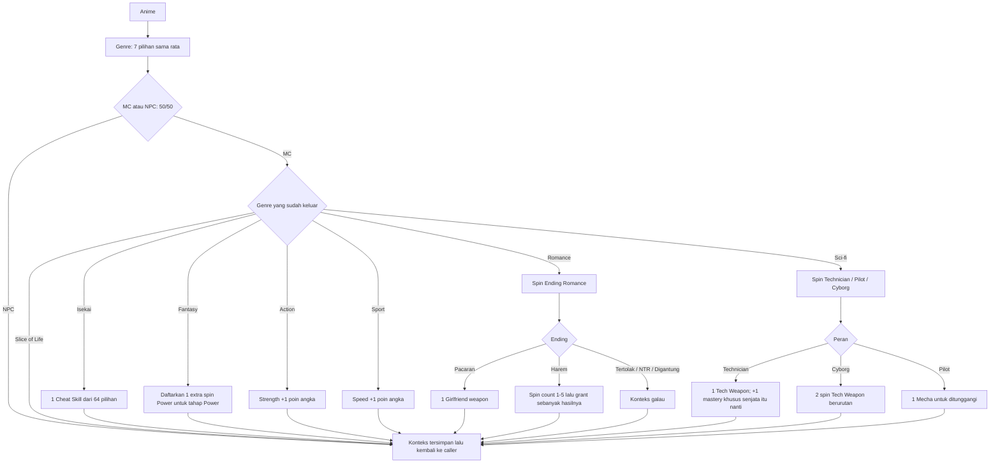

# Event Anime

**Anime → Genre → MC/NPC 50:50 → event genre hanya untuk MC → kembali ke caller.**
Nama layar kini **Anime**; ID family tetap `anime-lineage`. Roda utama tetap 17 family, Anime berada di luar Reinkarnasi Pahlawan Legendaris. Urutan terakhir pengguna menggantikan usulan MC/NPC dahulu dan selector tujuh MC bernama sebelumnya. Selector lama tersimpan sebagai history nonaktif dalam [desain Anime](../content/anime-events-design.json).

Setiap Genre mendapat bobot dasar 1: peluang awal **1/7 ≈ 14,29%**. Roda MC/NPC tetap tepat 50:50 untuk setiap genre. NPC menyimpan hasil genre dan posisi; semua cabang MC dilewati. MC menjalankan genre yang telah tercatat, tanpa spin Genre kedua.

| Genre | Event ketika MC | Contoh konteks saat event diketahui |
| --- | --- | --- |
| Isekai | 1 spin Cheat Skill, mendapat 1 power hasilnya | “Pindah dunia, waktunya cek paket cheat.” |
| Fantasy | 1 extra spin Power nanti | “Masuk fantasy, dapat satu tiket Power tambahan.” |
| Romance | Ending → Girlfriend weapon atau konteks galau | “Sekarang RNG ikut ngurus hubungan.” |
| Sci-fi | Technician / Pilot / Cyborg | “Role keluar, baru kita cari gear.” |
| Action | +1 poin angka Strength | “Genre action: modal gebuk naik satu.” |
| Sport | +1 poin angka Speed | “Opening latihan dapat hasil: Speed tambah satu.” |
| Slice of Life | Lanjut | “Spotlight dapat, hidupnya tetap daily quest.” |

Konteks NPC: **“Genre sudah bagus, kameranya ternyata lewat doang.”** NPC tidak mendapat Cheat, tiket Fantasy, ending Romance, peran Sci-fi, kendaraan, atau bonus Action/Sport dari cabang ini. Setiap spin dan grant yang benar-benar keluar menambah konteks berlapis dengan ID sumbernya.

## Romance

| Ending | Bobot | Peluang | Efek |
| --- | --- | --- | --- |
| Pacaran | 1 | 1/7 ≈ 14,29% | 1 Girlfriend sebagai weapon |
| Tertolak | 2 | 2/7 ≈ 28,57% | Konteks galau saja |
| NTR | 1 | 1/7 ≈ 14,29% | Konteks galau saja |
| Harem | 1 | 1/7 ≈ 14,29% | Spin jumlah 1–5, masing-masing 20%, lalu dapat sebanyak itu |
| Digantung | 2 | 2/7 ≈ 28,57% | Konteks galau saja |

Girlfriend mengikuti klasifikasi weapon dari pengguna. Pacaran langsung memberi satu instance, tanpa roda jumlah. Harem memberi tepat N instance berbeda dari satu hasil count, termasuk N=1. Semua instance dipertahankan dan mendapat Weapon Mastery masing-masing pada tahap Weapon. Roda Weapon utama tetap berjalan; None menambah nol senjata dan tidak menghapus Girlfriend. Tidak ada selector tipe pacar atau penalti stat untuk ending sedih.

Kompatibilitas Enchant dan aksi Girlfriend masih perlu desain, mengikuti gate senjata Master+ biasa ketika profilnya tersedia. Hasil Harem tidak otomatis memberi bonus mastery atau power pasangan.

## Sci-fi

Technician, Pilot, dan Cyborg memakai bobot dasar **1:1:1**, masing-masing 1/3.

| Peran | Event | Mastery |
| --- | --- | --- |
| Technician | 1 spin roda Tech Weapon 20 pilihan | **+1 Weapon Mastery hanya Tech Weapon hasil Technician**, sesuai jawaban pengguna |
| Cyborg | 2 spin berurutan pada roda Tech yang sama | Weapon Mastery normal untuk tiap instance; tidak menerima bonus Technician |
| Pilot | 1 spin Mecha: 20 unit dari 20 franchise | Kendaraan untuk ditunggangi; sistem kendali/persenjataan masih perlu profil |

Tech Weapon langsung dimiliki, dengan mastery belum diputar. Untuk Technician, catat target instance dari actual Tech spin. Pada tahap Weapon: **spin base mastery sekali → tambah satu rank khusus instance itu → cap → reaksi → cek Enchant kompatibel terhadap effective rank Master+**. Jika base satu rank di bawah Master dan +1 mencapai Master, Enchant bisa terbuka. Skala rank masih pending. Bonus tidak berpindah ke senjata utama, GF, Cyborg, Gnome, atau mecha; replay tidak menambah +1 lagi.

Cyborg memiliki dua actual spin dan dua reaksi berurutan. Interpretasi kerja memakai pool yang sama tanpa exclusion baru: hasil yang sama boleh keluar dua kali, tetap dicatat sebagai dua weapon instance. Reaksi pertama belum mengetahui hasil kedua. Semua tetap dimiliki saat roda Weapon utama mendapat None.

Mecha dicatat di inventori kendaraan sebagai **interpretasi kerja**. Satu hasil memberi satu unit untuk ditunggangi. Detail kru, kontrol, mounted weapons, form dan ukuran belum ditentukan. Ukuran kendaraan tidak mengganti Size tubuh karakter. Detail mesin juga tidak otomatis menjadi personal power, senjata terpisah, bonus stat atau hasil mastery. Katalog lengkap ada di [Tech Weapon dan Mecha](SCIFI-TECH-MECHA.md).

## Isekai dan Fantasy

[Roda Cheat Skill](ISEKAI-CHEAT-SKILLS.md) berisi **64 referensi anime berbeda**, satu efek game per pilihan, peluang dasar 1/64. Judul sumber disimpan terpisah dari label pendek roda, scope power, dan punchline narator. Daftar dapat kita tambah/kurangi. Vending machine, pedang, babi, Level 1, Level 2, dan Villainess Level 99 menjadi contoh variasi absurd.

Powers yang tercatat adalah **adaptasi game**, dengan limits/mastery/range masih perlu balance. Level pada judul merupakan referensi, tidak langsung menetapkan stat atau rank mastery. Bentuk tubuh dari premis reinkarnasi belum otomatis diterapkan. Return by Death tercatat sebagai power naratif; kemampuan itu tidak menjalankan respin atau menulis ulang jurnal RNG tanpa aturan event tersendiri.

Fantasy mendaftarkan satu ticket extra normal Power. Urutannya: main Power dan detail → semua bonus Power dan detail → **satu Power Mastery bersama** jika inventory power terisi. Extra spin dapat mendapat None mengikuti aturan normal; God scarcity 80/20 tetap berlaku bila caller memenuhi guard. Cheat awal bertahan meskipun Power utama None dan ikut hasil mastery bersama. Power Mastery tetap tidak membuka Enchant.

## Konteks, nested caller, dan peluang lanjutan

Simpan per komponen: family → Genre → MC/NPC → ending/peran/child result → grant/modifier/ticket actual → mastery yang sudah keluar. Pada reaksi Genre, MC/NPC belum diketahui. Setelah MC keluar, AI mengetahui hanya event yang terbuka dan fixed effects yang sudah diterapkan. Hasil child yang belum diputar tidak dibocorkan. Setiap actual spin mendapat beat meme dan teks; fixed grant menyatu dengan reaksi hasil pemicunya.

Jika Anime berasal dari inang Symbiote, ras dasar Raksasa, asal undead atau root Hybrid, jalankan flow ini lalu pulihkan caller yang tersimpan. Genre, judul anime dan mecha tidak memakai slot ras baru atau menjalankan event ras lain. Archetype utama dimulai setelah seluruh chain ras terluar selesai.

Modifier peluang lanjutan dari genre/tags masih semantic draft sampai bobot/guard ditentukan; tidak ada rarity tambahan karena judul panjang atau power kuat. MC/NPC dan Ending Romance mempertahankan distribusi khusus. Banana Peel Launcher ditandai funny-result dalam katalog Tech sesuai contoh lucu pengguna: bila Shrek sudah aktif, actual spin itu memakai hook +1 kelima stat sekali. Caption lucu lainnya tidak menjadi bonus otomatis.

Aturan terstruktur: [Anime](../content/anime-events-design.json), [Cheat](../content/isekai-cheat-wheel-design.json), [Tech](../content/universal-tech-weapon-wheel-design.json), [Mecha](../content/anime-mecha-wheel-design.json), dan [spesifikasi framework](../framework/spec.json). Sumber riset ada di [manifest Anime](../reference/anime-content-research.json).
