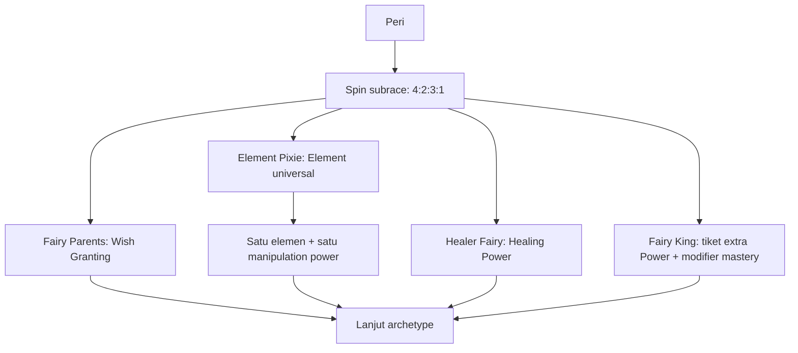

# Event Peri dan Element Universal

Keluarga Peri mempunyai empat subrace dengan peluang tetap **Fairy Parents 40%, Element Pixie
20%, Healer Fairy 30%, Fairy King 10%**. Grant power ditambahkan saat hasil ras selesai;
mastery menunggu tahap Power. Fairy King memberi satu extra Power spin serta **+2 Power Mastery
untuk semua power yang dimiliki**, sesuai klarifikasi pengguna.

## Jenis Peri dan alur event

| Subrace | Bobot | Peluang | Event atau efek |
| --- | --- | --- | --- |
| Fairy Parents | 4 | 40% | Tambahkan Wish Granting |
| Element Pixie | 2 | 20% | Spin Element universal; tambahkan manipulation power elemen terpilih |
| Healer Fairy | 3 | 30% | Tambahkan Healing Power |
| Fairy King | 1 | 10% | Satu extra Power spin nanti dan +2 mastery seluruh power |



Urutan 4:2:3:1 mengikuti daftar pengguna. Total bobot 10; modifier biasa tidak mengubah rasio
ini. Tidak ada selector Dryad/Bunian/Bidadari tambahan. Kandidat sebelumnya tetap menjadi
riwayat usulan, sedangkan empat pilihan di atas merupakan roda aktif yang ditetapkan pengguna.
Setiap actual spin memiliki hasil, konteks, reaksi narator, meme, dan caption sendiri.

## Fairy Parents dengan Wish Granting

Wish Granting berarti power pengabul harapan melalui aturan wish yang nantinya menentukan
jenis harapan, biaya, sasaran, jumlah penggunaan, dan batas efek. Hasil subrace memberikan
tepat satu owned power ini, dengan mastery belum diputar. Tidak ada extra Wish wheel, tiga
jatah wish, companion kedua, atau power lain yang otomatis ditambahkan.

Power bukan izin bagi narator untuk mengubah hasil spin yang sudah dicatat. Jika wish nantinya
membuka grant/event, efeknya harus mempunyai guard, provenance, batas, dan return point yang
didefinisikan dalam katalog. Detail penggunaan wish belum diputuskan.

Konteks: “Fairy Parents mendapat Wish Granting. Batas power dan penguasaannya belum ditentukan;
power sudah dimiliki dan akan mengikuti Power Mastery nanti.”

## Element Pixie dan satu roda Element universal

Roda global **element-universal** dipakai semua pemanggil yang memenuhi guard akses.
Element Pixie membuat tepat satu invokasi, mencatat elemen terpilih, lalu mendapat satu
manipulation power yang sesuai. Naga memakai roda yang sama dengan sumber hasil Naga.
Golem Elemen juga memakai selector yang sama. Caller mempertahankan identitasnya dan tidak
membuka event ras Elemental. Makara mendapat
Kendali Air dari definisi yang sama sebagai fixed grant, tanpa spin Element.

Roda bersama sekarang mempunyai 12 pilihan:

| Elemen | Power yang ditambahkan | Scope |
| --- | --- | --- |
| Api | Fire Manipulation (Kendali Api) | Membentuk dan mengendalikan api. |
| Air | Water Manipulation (Kendali Air) | Membentuk dan mengendalikan air. |
| Tanah | Earth Manipulation (Kendali Tanah) | Membentuk dan mengendalikan tanah serta batu dalam batas power yang ditetapkan. |
| Angin | Wind Manipulation (Kendali Angin) | Membentuk dan mengendalikan aliran udara serta angin. |
| Petir | Kendali Petir | Mengendalikan petir dan listrik sesuai scope power. |
| Es | Kendali Es | Membentuk dan mengendalikan es. |
| Logam | Kendali Logam | Mengendalikan logam. |
| Tumbuhan | Kendali Tumbuhan (Forest Control) | Mengendalikan tumbuhan, akar, dan struktur hutan. |
| Cahaya | Kendali Cahaya | Mengendalikan cahaya sebagai power biasa. |
| Kegelapan | Kendali Kegelapan | Mengurangi atau menghalangi cahaya. |
| Bayangan | Manipulasi Bayangan | Mengendalikan bentuk bayangan. |
| Void | Kendali Kekosongan | Memakai scope Void kanonis; mastery tetap normal. |

Semua pilihan memakai bobot dasar 1 (sekitar 8,33% sebelum modifier). Rasio 4:2:3:1
tetap berlaku pada subrace; distribusi Size tetap terpisah. Tier intrinsik dan referensi
power ada di [panduan Element](ELEMENT-WHEEL.md).

Fire Manipulation mempunyai satu definisi yang sama untuk hasil Api pada Pixie dan grant
Summer pada Fey Elf. Power mempertahankan ID, nama, dan scope lamanya. Fakta musim Summer
berada pada sumber grant Fey Elf; Pixie tidak mewarisi musim itu hanya karena mempunyai Api.
Range, cost, resistance, durasi, serta batas manipulation menunggu balance.

Konteks sebelum elemen: “Element Pixie akan memilih satu elemen; hasilnya belum diketahui.”
Sesudah hasil: elemen terpilih + satu power terkait + mastery pending. Elemen lain tidak
ikut menjadi kemampuan karakter. Konteks universal memakai identitas pemanggil yang sebenarnya.

## Healer Fairy dengan Healing Power

Healing Power memulihkan luka atau damage pada target yang memenuhi aturan power. Hasil
memberikan tepat satu owned Healing Power. Target, jumlah heal, cost, dan batas mastery
akan ditetapkan kemudian. Revival, immortality, atau kemampuan regenerasi tambahan tidak
otomatis diberikan. Tidak ada roda healing lain yang diminta.

Konteks: “Healer Fairy memperoleh Healing Power. Besaran pemulihan dan penguasaannya belum
diketahui; mastery diputar pada tahap Power.”

## Fairy King dan bonus pada seluruh power

Saat King terpilih, catat satu tiket extra Power spin dan modifier mastery +2. Pada tahap Power:

```text
Main Power acquisition + event/detail
  → Extra Power spin Fairy King + event/detail
  → Cek seluruh daftar owned powers
      ├─ Kosong: skip mastery
      └─ Ada: spin satu base Power Mastery bersama
              → Tambahkan +2 sekali ke rank bersama, sampai batas maksimum
              → Semua power memakai hasil rank yang sama
              → Catat rank dasar, rank efektif, sumber bonus, dan reaksi
  → Weakness
```

Tiket dipakai satu kali, dengan source invocation dan component slot sendiri. Peluang draw
bonus dibekukan dari pool yang berlaku saat tahapnya tiba. Interpretasi extra spin mengikuti
aturan Shaman: jika None ada di pool Power yang disepakati, hasil itu tetap mungkin. Main
None tidak menghapus power ras atau grant lain. Dua hasil None dengan inventori kosong tidak
menciptakan power atau mastery palsu.

Klarifikasi pengguna **“Semua power yang dimiliki”** mencakup grant awal, main draw, hasil
bonus, serta grant baru yang memang diotorisasi kemudian. Interpretasi +2 yang dipakai adalah
**dua tingkat pada urutan rank mastery**; label rank dan batas maksimum masih menunggu desain.

```text
sharedEffectiveRankIndex = clamp(sharedRolledRankIndex + 2, rankMinimum, rankMaximum)
```

Hasil base mastery tidak diubah atau diulang. Simpan base/effective rank dan modifier tersendiri.
Contoh ilustratif: base rank 2 menjadi rank 4; jika kenaikannya melewati rank maksimum, berhenti
di maksimum. Contoh ini tidak menetapkan jumlah atau nama rank pada katalog.

Modifier +2 diterapkan sekali ke rank Power Mastery bersama, lalu seluruh power memakai rank
itu. Jumlah power tidak mengalikan bonus. Evaluasi/render ulang tetap memakai base tersimpan.
Bila King aktif belakangan, hitung ulang rank bersama dari base yang sama. Power baru langsung
mewarisi hasil bersama tanpa spin mastery tambahan. [Aturan global](POWER-MASTERY.md) berlaku.

Bonus ini tidak meningkatkan Weapon Mastery atau lima main stat. Power Mastery tetap tidak
membuka enchant, bahkan jika +2 melewati Master. Reward pasif yang sudah mempunyai angka
tetap, seperti +1 stat Shrek, tidak otomatis berubah karena modifier mastery ini.

## Konteks berlapis dan Size

| Hasil yang baru selesai | Fakta untuk narator |
| --- | --- |
| Peri | Keluarga terpilih; subrace masih unknown |
| Fairy Parents | Wish Granting owned; mastery dan detail penggunaan pending |
| Element Pixie | Event Element dibuka; hasil elemen unknown |
| Element | Elemen aktual dan satu manipulation power; sumber caller dan mastery pending |
| Healer Fairy | Healing Power owned; jumlah heal dan mastery pending |
| Fairy King | Satu tiket bonus Power dan +2 untuk seluruh owned powers; hasil berikutnya unknown |
| Power Mastery King | Raw rank aktual, final rank tanpa floor/cap, +2 source di akhir |

Semua subrace mengikuti Size global sesudah Backstory dan sebelum stats. Bentuk tubuh serta
acuan ukuran bersumber untuk Parents/Pixie/Healer/King belum ditentukan; jangan menyalin
rata-rata Human/Gnome atau menganggap semuanya sama. Subrace, elemen, grant, tiket, dan
modifier hanya masuk konteks sesudah committed, dengan provenance.

Data: [fairy-events-design.json](../content/fairy-events-design.json),
[Element universal](../content/universal-element-wheel-design.json),
[routing ras](../content/race-wheel-design.json), dan [framework](../framework/spec.json).
Daftar elemen, skala mastery, batas wish/heal/manipulation, profil Size, dan odds effects
masih pekerjaan balance.
