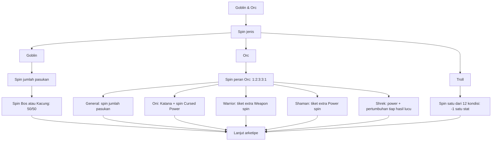

# Goblin, Orc, dan Troll

Keluarga ke-4 dari 17: **Goblin & Orc → Goblin / Orc / Troll**. Ketiga jalur mengikuti aturan
pengguna. Rasio yang disebutkan tetap; jenis Goblin/Orc/Troll masing-masing 1/3, kondisi Troll 1/12,
dan senjata kocak 1/12 sebelum modifier, sesuai default sama rata. Framework masih rancangan, belum menjadi generator yang berjalan.

## Alur keluarga



Setiap spin jenis, jumlah pasukan, posisi, peran, Cursed Power, dan kondisi mendapat hasil,
konteks, serta reaksi narator sendiri. Grant tetap dan pencatatan tiket tidak membuat spin baru.

## Goblin: jumlah pasukan lalu posisi

| Pasukan | Bobot | Peluang setelah Goblin terpilih |
| --- | --- | --- |
| 0 | 5 | 10,87% |
| 5 | 10 | 21,74% |
| 20 | 15 | 32,61% |
| 100 | 10 | 21,74% |
| 1.000 | 5 | 10,87% |
| 10.000 | 1 | 2,17% |

Total bobot **46**. Peluang di atas dibulatkan untuk tampilan; perhitungan memakai pecahan
bobot/46. Sesudah itu **Bos 50% / Kacung 50%**, termasuk bila jumlah pasukan **0**.
Rasio ini tetap dan tidak berubah oleh modifier biasa.

- **Bos:** memimpin jumlah pasukan yang baru didapat. Nol tetap sah: bos tanpa anak buah.
- **Kacung:** berada dalam unit sebesar hasil jumlah pasukan, tetapi kendali pasukan pribadinya 0.

Contoh konteks setelah 10.000 pasukan, sebelum posisi: “Ada unit 10.000 pasukan; posisi belum
ditentukan.” Setelah Kacung: “Unitnya 10.000 orang, tetapi karakter ini kacung, bukan komandannya.”
Jangan menyebut seluruh unit sebagai pasukan milik karakter sebelum posisi diputuskan.

Jumlah unit, posisi, dan pasukan yang dikendalikan disimpan terpisah dengan asal spin dan slot
komponen. Ukuran pasukan tidak otomatis menambah lima stat pribadi. Profil pasukan dan kontribusi
pertempurannya akan dirancang kemudian.

## Orc: lima peran

| Hasil | Bobot | Peluang setelah Orc terpilih | Event atau grant |
| --- | --- | --- | --- |
| Orc General | 1 | 10% | Spin jumlah pasukan; memimpin hasilnya |
| Oni | 2 | 20% | Tambahkan Katana, lalu spin satu Cursed Power |
| Orc Warrior | 3 | 30% | Satu extra Weapon spin pada tahap senjata |
| Shaman | 3 | 30% | Satu extra Power spin pada tahap power |
| Shrek | 1 | 10% | Shrek Power; setiap hasil spin lucu berikutnya memberi +1 pada kelima stat |

**General** memakai roda jumlah pasukan yang sama sebagai interpretasi kerja; pengguna belum
memberikan rasio General yang terpisah. General tidak membuka Bos/Kacung lagi. Nol pasukan
tetap hasil sah. Konteks: “Perannya General; besar pasukan ditentukan putaran berikutnya.”

**Oni** memakai roda Cursed Power yang sudah ada pada [Event Elf](ELF-EVENTS.md#dark-elf-cursed-power),
dengan 12 opsi yang sama dari [roda power universal](UNIVERSAL-POWER-WHEELS.md). ID selector global kini `power-cursed`; keluarga pemanggil tetap Oni,
bukan Elf. Setelah satu power diberikan, kembali ke jalur Oni lalu arketipe. Katana dan power
terpilih masuk inventori dengan mastery belum ditentukan. Konteks: “Oni membawa Katana dan akan
memperoleh satu Cursed Power; jenis power belum diketahui.” Ras dasar dicatat sebagai Oni.

**Warrior** mendapat tiket satu spin senjata tambahan. Pada tahap Weapon, hasil utama dan
detailnya selesai dahulu, lalu spin tambahan. Karena pengguna menghendaki senjata tambahan,
opsi None dikeluarkan dari draw bonus sebelum peluang dinormalisasi. Jika tidak ada senjata
yang cocok, konfigurasi gagal; hasil tidak diganti atau diulang. Konteks: “Warrior memiliki
satu kesempatan senjata tambahan; senjatanya belum diketahui.”

**Shaman** mendapat tiket satu extra Power spin nanti. Spin tambahan memakai aturan pool Power
yang berlaku; jika None terdapat di pool yang disepakati, None tetap mungkin. Ini interpretasi
atas permintaan extra spin. Konteks: “Shaman mendapat putaran Power tambahan nanti; belum ada
power baru dari tiket ini.”

Urutan tahap yang dipakai sebagai desain penjadwalan:

```text
Weapon: hasil utama + detail → semua tiket bonus Weapon + detail
        → mastery seluruh senjata yang belum dimaster → enchant yang memenuhi syarat → Power
Power:  hasil utama + detail → semua tiket bonus Power + detail
        → mastery seluruh power yang belum dimaster → Weakness
```

Peluang setiap draw bonus dihitung ulang dari build saat itu, lalu dibekukan sebelum spin.
Tiket menyimpan sumber, tahap, status, slot komponen, dan ID spin pemakai; satu tiket hanya
berhasil dikonsumsi sekali. Semua draw bonus mendapat reaksi dan dihitung ke batas extra spin.
Grant yang muncul setelah tahapnya lewat menjalankan subflow sendiri lalu kembali ke pemanggil.
None pada hasil utama tidak menghapus Katana, power ras, atau grant tambahan yang telah dimiliki.
Mastery senjata Master atau lebih membuka enchant yang cocok; Power Mastery tidak membuka enchant.

## Shrek: bonus berulang dari hasil lucu

Nama power sementara: **Shrek Power — Comedy Ascension (Tenaga Kekacauan)**. Shrek diposisikan
sebagai profil Orc paling kuat melalui potensi pertumbuhan berulang. Stat awal dan mastery
tetap dihasilkan lewat tahap utama. Ras dasarnya **Ogre**. Pilihan ini tidak otomatis membuka
event Raksasa, Demon, Anime MC, atau Reinkarnasi Pahlawan Legendaris.

Klarifikasi pengguna: **setiap hasil spin lucu**, bukan satu bonus saat memperoleh Shrek.
Setiap hasil spin berikutnya yang mempunyai tag mekanik `funny-result` memberi:

| Stat | Bonus setiap hasil lucu |
| --- | --- |
| Strength | +1 poin angka |
| Speed | +1 poin angka |
| Durability | +1 poin angka |
| Intelligence | +1 poin angka |
| Fight | +1 poin angka |

Power aktif ketika diperoleh. Saat Shrek terpilih, bonus masih **0**. Sesudah satu hasil lucu,
bonus kumulatif +1 tiap stat; sesudah dua hasil berbeda, +2 tiap stat. Hasil lucu dapat berasal
dari tahap mana pun setelah perolehan power jika katalog menandainya secara eksplisit. Tidak
ada bonus mundur untuk spin sebelum Shrek. Power Mastery tetap dilakukan nanti; mastery tidak
otomatis mengubah besaran +1 yang sudah ditetapkan.

Kunci bonus adalah run + hook + ID spin yang memenuhi syarat. Hasil dan bonus dicatat dalam
satu transaksi sebelum konteks reaksi dibuat. Evaluasi ulang, render ulang, meme berbeda,
caption lucu, atau reveal tetap tidak menambah bonus. Modifier bonus sendiri bukan spin, sehingga
tidak dapat memicu pertumbuhan tanpa akhir. Narator tidak memutuskan tag mekanik.

### Draft 12 senjata kocak

Penempatan yang diusulkan: varian roda **Weapon utama** ketika Shrek aktif, bukan spin ras
tambahan. Semua hasil mempunyai tag `funny-result`, memberi tepat satu senjata, lalu mengikuti
Weapon Mastery dan enchant biasa jika kompatibel. Usulan varian ini dan bobotnya masih dapat
disesuaikan. Nama dan fungsi senjata adalah adaptasi permainan.

| No. | Senjata | Fungsi draft |
| --- | --- | --- |
| 1 | Banana Peel Launcher | Melontarkan kulit pisang sebagai jebakan licin. |
| 2 | Onion Cannon (Meriam Bawang) | Menembakkan bawang untuk proyektil dan gangguan. |
| 3 | Giant Frying Pan (Wajan Raksasa) | Wajan besar untuk pukulan jarak dekat. |
| 4 | Rubber Chicken Mace (Gada Ayam Karet) | Gada ayam karet dengan bunyi absurd. |
| 5 | Plunger Spear (Tombak Sedot WC) | Tombak berkepala alat sedot untuk dorongan dan kontrol. |
| 6 | Baguette Club (Pentungan Roti) | Roti keras versi fantasi sebagai pentungan. |
| 7 | Swamp Slingshot (Ketapel Lumpur) | Ketapel yang melontarkan lumpur. |
| 8 | Squeaky Hammer (Palu Cit-Cit) | Palu yang berbunyi cit-cit ketika memukul. |
| 9 | Burp Bazooka (Bazoka Sendawa) | Alat bazoka yang menghasilkan serangan suara sendawa. |
| 10 | Slipper Boomerang (Bumerang Sandal) | Sandal lempar berbentuk bumerang. |
| 11 | Rolling Pin (Penggilas Adonan) | Penggilas adonan sebagai pentungan dapur. |
| 12 | Giant Spoon (Sendok Raksasa) | Sendok besar sebagai alat pukul. |

Efek alat tidak otomatis memberikan power pribadi lain. Damage, batas penggunaan, dan
enchantability belum ditetapkan. Urutan tabel adalah urutan katalog, bukan peringkat kekuatan.

Konteks hasil berikut dipakai setelah senjata benar-benar diperoleh oleh Shrek aktif dan hook
bonusnya tercatat. Jika konten senjata digunakan melalui jalur lain, proyeksi konteks hanya
menyebut bonus ketika kondisi power terpenuhi.

| Hasil | Konteks untuk narator |
| --- | --- |
| Banana Peel Launcher | Dapat senjata pelontar kulit pisang. Hasil ini bertag lucu, sehingga Shrek mendapat +1 pada kelima stat. |
| Onion Cannon (Meriam Bawang) | Meriamnya menembakkan bawang; Shrek tetap menerima bonus lima stat dari hasil lucu ini. |
| Giant Frying Pan (Wajan Raksasa) | Wajan besar masuk daftar senjata. Bonus Shrek berasal dari tag hasil lucunya, bukan besar damage yang belum ditentukan. |
| Rubber Chicken Mace (Gada Ayam Karet) | Senjata ayam karet menjadi hasil lucu yang mengaktifkan bonus Shrek. |
| Plunger Spear (Tombak Sedot WC) | Tombak sedot WC didapat. Bentuk absurdnya sudah ditandai sebagai hasil lucu di katalog. |
| Baguette Club (Pentungan Roti) | Pentungan roti masuk inventori; ini satu hasil lucu, jadi bonus lima stat diterapkan satu kali. |
| Swamp Slingshot (Ketapel Lumpur) | Ketapel lumpur didapat sebagai senjata bertema rawa dan hasil lucu bagi Shrek. |
| Squeaky Hammer (Palu Cit-Cit) | Palu cit-cit masuk daftar senjata; hasil ini menambah kelima stat Shrek meski daya senjatanya masih perlu balance. |
| Burp Bazooka (Bazoka Sendawa) | Bazoka sendawa diperoleh sebagai alat senjata. Hasil lucunya mengaktifkan bonus Shrek tanpa memberi power suara terpisah. |
| Slipper Boomerang (Bumerang Sandal) | Sandal menjadi senjata bumerang; bonus hasil lucu Shrek dicatat sebelum reaksi dibuat. |
| Rolling Pin (Penggilas Adonan) | Alat dapur menjadi senjata tempur dan satu pemicu bonus hasil lucu Shrek. |
| Giant Spoon (Sendok Raksasa) | Sendok raksasa didapat; label lucu pada hasil ini memicu +1 untuk kelima stat Shrek. |

[Sinopsis resmi DreamWorks](https://www.dreamworks.com/movies/shrek-forever-after) mendukung
identitas Shrek sebagai Ogre. Power, bonus angka, dan senjata kocak di sini adalah desain game.

## Troll: satu kondisi dari 12

| No. | Hasil | Efek permainan | Asal mapping |
| --- | --- | --- | --- |
| 1 | Asma | −1 Speed | Contoh pengguna |
| 2 | Penyakit Kulit | −1 Durability | Contoh pengguna |
| 3 | Anemia | −1 Strength | Draft permainan |
| 4 | Maag | −1 Strength | Draft permainan |
| 5 | Flu | −1 Speed | Draft permainan |
| 6 | Radang Sendi | −1 Fight | Draft permainan |
| 7 | Migrain | −1 Intelligence | Draft permainan |
| 8 | Insomnia | −1 Intelligence | Draft permainan |
| 9 | Rabun | −1 Fight | Draft permainan |
| 10 | Asam Urat | −1 Speed | Draft permainan |
| 11 | Demam | −1 Strength | Draft permainan |
| 12 | Infeksi Rawa | −1 Durability | Draft permainan |

Asma dan Penyakit Kulit mengikuti contoh pengguna; sepuluh lainnya adalah draft yang
didelegasikan. **Infeksi Rawa** adalah kondisi fiktif. Semua mapping merupakan aturan build
fantasi, bukan pengukuran kondisi orang nyata. Kedua belas pilihan memakai bobot dasar 1, jadi masing-masing 1/12 sebelum modifier.

Spin memberikan tepat satu kondisi dan satu modifier −1 poin angka yang terkait dengan
ID hasil tersebut. Modifier disimpan sebelum main stat lalu diterapkan sekali terhadap base
stat dengan batas skala yang disepakati. Kondisi ini tidak menggantikan spin Weakness nanti.
Konteks setiap kondisi mencatat nama, stat target, dan −1; kandidat lain tidak ikut menjadi
fakta karakter. Reaksi komedi diarahkan ke nasib build karakter.

## Konteks bertumpuk dan balance berikutnya

Lapisan fakta: keluarga → jenis → peran → hasil event → grant/tiket/posisi/kondisi → hasil
tahap berikutnya. Reaksi hanya membaca fakta sampai spin tersebut. Tiket belum menjadi
senjata/power, pasukan belum menjadi milik Goblin sebelum posisi, dan bonus Shrek belum muncul
sebelum hasil lucu dicatat. Setiap fakta menyimpan sumber dan scope komponennya.

Seluruh lima stat kini memerlukan skala angka atau mapping eksplisit agar +1 Shrek dan −1
Troll terhitung sebagai poin, bukan kenaikan/penurunan tier. Batas skala, efek probabilitas
masa depan, profil army, jumlah maksimum bonus dalam episode, opsi funny pada roda lain,
kompatibilitas, dan pengaruh peluang selanjutnya masih menunggu desain balance.
Bobot dasar yang belum diberikan memakai 1 per pilihan eligible sesuai default pengguna.

Data: [goblin-orc-troll-events-design.json](../content/goblin-orc-troll-events-design.json).
Routing roda: [race-wheel-design.json](../content/race-wheel-design.json).
Kontrak umum: [spec.json](../framework/spec.json).
