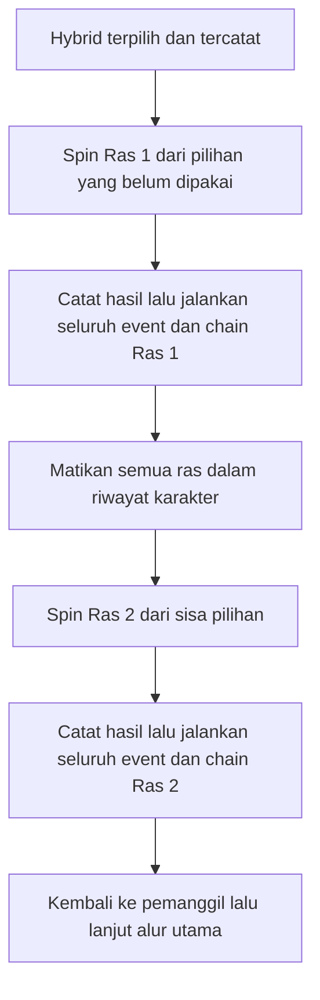

# Hybrid: Dua Ras dan Satu Riwayat Bersama

**Hybrid mendapat dua cabang ras.** Spin ras pertama dari roda ras utama, jalankan event
ras itu seperti biasa beserta seluruh chain langsungnya. Setelah cabang pertama selesai,
spin ras kedua dengan seluruh ras yang sudah muncul dinonaktifkan. Cabang kedua juga
menjalankan event normal dan setiap chain yang dibukanya.

Tidak ada spin stabilitas atau dominasi pada alur yang disepakati ini. Dua spin Hybrid memakai
pool kanonis race-family yang sama. Semua 22 keluarga menjadi sumber pool, termasuk Machine, Anime,
Heavenly Principle dan Reinkarnasi Pahlawan Legendaris; filter riwayat diterapkan sebelum draw. Hybrid sendiri
sudah tercatat ketika event dimulai, sehingga tidak bisa terpilih lagi.



## Contoh dari pengguna

```text
Hybrid
  Cabang 1: Symbiote → Raksasa → Abyssal Axiom
             inang      ras dasar   event Abyssal normal
  Tunggu seluruh event langsung cabang 1 selesai
  Cabang 2: spin ras dengan Hybrid, Symbiote, Raksasa, Abyssal Axiom dimatikan
             → jalankan event hasil cabang 2
  Kembali ke pemanggil
```

Canonical IDs yang sudah dipakai: hybrid, symbiote, raksasa, demon. Giant adalah Raksasa;
Demon kini berlabel Abyssal Axiom. Bila tidak ada ras lain di riwayat atau guard lain,
spin ras kedua mempunyai **18 pilihan**, memakai bobot kanonis yang dinormalisasi setelah exclusion.
Hasil ras kedua tidak ditentukan di muka. Bila sebuah event sebelumnya juga mendapatkan
Lelembut atau Elf, keluarga itu ikut dikeluarkan.

## Symbiote menempel pada ras inang

Aturan diklarifikasi pengguna: Symbiote selalu membuka **satu spin ras inang**, yang
menjalankan event normal. Rantai inang dapat membuka Raksasa, Lelembut origin, atau caller
lain yang memang disetujui. Wrapper Symbiote tetap tercatat dan terikat pada inang sebenarnya.

Urutan kerja: hasil Symbiote/reaction → ras inang dan semua event langsungnya → kembali ke
Symbiote → Takeover sekali → Symbiote Power sesuai hasil Takeover → saved caller.
Takeover dan bonusnya tetap seperti [event Symbiote](SYMBIOTE-EVENTS.md). Host spin berasal
dari event family, bukan tambahan per hasil Takeover; 0% tetap menyimpan Symbiote dan inangnya.

## Raksasa adalah versi raksasa dari ras berikutnya

Raksasa selalu membuka **satu spin ras dasar**, lalu menjalankan event ras hasil itu.
Identitas menjadi versi raksasa dari hasil tersebut. Binding Size Raksasa tetap
dicatat sekali dari sumber. Sesudah seluruh Race tree selesai, policy 1.0.0
melewati Archetype; ticket kedua sebelumnya sudah dipensiunkan.

Urutan kerja: hasil Raksasa/reaction dan pendaftaran bonus → ras dasar beserta event langsungnya
→ kembali ke pemanggil. Lihat [Size/Raksasa](SIZE-RAKSASA-EVENTS.md).

## History, caller dan bonus

Satu raceSelectionHistory/usedRaceFamilyIds dipakai untuk seluruh karakter. Semua actual family
draw main, dua root Hybrid, host Symbiote, base Raksasa dan origin Skeleton/Zombie masuk set yang
sama **sebelum** child event dijalankan. Subtype bukan pemilihan family lagi; nama ras yang sekadar
menjadi lore atau mangsa Vampire tetap mengikuti kontrak referensinya.

Setiap draw memfilter semua used families, memakai bobot kanonis/modifier yang disetujui,
menormalisasi sisa pilihan, lalu membekukan odds. Tidak ada reroll hasil yang sudah committed.
Sumber event dan history tidak di-reset ketika pindah root. Pool wajib yang habis menjadi
configuration error, bukan alasan mengembalikan ras yang sudah dipakai.

Nested host/base tetap berada di cabang Hybrid yang memanggilnya. Simpan dua root slots,
parent/component IDs, link inang/ras dasar dan saved continuation. Selesai event Abyssal pada
contoh akan kembali ke Raksasa, lalu Symbiote, lalu Hybrid root 2; tidak langsung lompat ke
Archetype. Deferred tickets untuk Weapon/Power dan binding Size menunggu tahapnya sendiri.
Archetype dinilai satu kali untuk seluruh gabungan; Raksasa di tree membuatnya skip.

Seluruh power, weapon, modifier, guarantee dan ticket yang secara eksplisit diberikan event
tetap dimiliki. Ledger mengaplikasikan tiap sumber sekali; angka final tanpa floor atau cap.
Satu karakter tetap mempunyai lima spin main stat, satu Size global dan satu Power Mastery
bersama. Raksasa di mana pun dalam tree mengaktifkan variant giant; tidak ada rata-rata ukuran
yang menghilangkan binding itu. Weapon Mastery/Enchant tetap mengikuti alur per weapon.

## Konteks AI dan pekerjaan berikutnya

Narator melihat roots/chain yang sudah committed, actual grants/bonuses dan sumbernya. Hasil
ras kedua dan stat akhir belum boleh disebut sebelum diputar. Contoh reaction Hybrid:
“Dua ras satu badan. Slot kedua nggak boleh nyomot ras yang sudah kepakai.” Contoh sesudah
chain pertama selesai: “Symbiote numpang di Raksasa Abyssal. Slot kedua, cari yang belum kepakai.”
Contoh narasi tidak memberi tag funny-result atau efek baru.

Resume memulihkan hasil, history dan posisi child yang tersimpan, lalu melanjutkan bagian yang
belum selesai. Ia tidak menggandakan sumber bonus atau memutar ulang result. Budget event/spin
yang masih usulan harus cukup untuk seluruh chain wajib; overflow menjadi configuration error.

**AI bebas mencampur tubuh dari ras yang benar-benar diperoleh**, tanpa mengutamakan ras pertama.
Symbiote tetap terikat pada inangnya; Raksasa tetap membesarkan ras dasarnya. Campuran visual tidak
memberi power/stat/ras tambahan. Buat satu blueprint tubuh yang koheren, validasi, lalu bekukan untuk
gate, gambar dan replay. Jangan membuat ulang tubuh untuk mencari pool Archetype yang lebih kuat.

Body references, adapter equipment, power limits dan anchor ukuran gabungan masih perlu
implementasi/konfigurasi. Tidak ada stability/dominance outcome tambahan.
Generator belum diimplementasikan.

Data: [Hybrid](../content/hybrid-events-design.json),
[Attachment callers](../content/race-attachment-events-design.json),
[Framework](../framework/spec.json).

## Dipanggil lewat Mutant

[Mutant](MUTANT-EVENTS.md) adalah caller tambahan roda Ras pada tahap Archetype. Jika mutation result membuka Hybrid/inang/ras dasar/origin, jalankan event tersebut dengan history yang sama lalu kembali ke saved Mutant caller. Jangan kembali ke gate Archetype. Mutant menambah satu root di samping ras awal; memiliki dua ras tidak otomatis memanggil event Hybrid.
