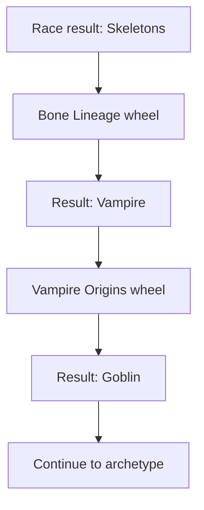

# Roda Kekacauan reference races

This preserves the video-derived roster before grouping. Use the [current race wheel](RACE-WHEEL.md)
for the working family structure.

The reference video supplies 39 identifiable race-wheel entries. This is the starting roster for
adding and removing races before designing their events and probabilities. Names retain the
video's spelling; the numbers below are review identifiers, not rarity or strength ranks.

## Reference roster

| Number | Race | Number | Race | Number | Race |
| --- | --- | --- | --- | --- | --- |
| 1 | Human | 14 | Spirit | 27 | Demi God |
| 2 | Gnomes | 15 | Werebeast | 28 | Voidwalker |
| 3 | Dwarf | 16 | Golem | 29 | Symbiote |
| 4 | Merfolk | 17 | Giant | 30 | Demon |
| 5 | Fairy | 18 | Vampire | 31 | Angel |
| 6 | Skeletons | 19 | Soulreaver | 32 | Hybrid |
| 7 | Dryad | 20 | Elemental | 33 | God |
| 8 | Troll | 21 | Dragonborn | 34 | Devil |
| 9 | Reptile | 22 | Mythical Beast | 35 | Primordial |
| 10 | Centaurs | 23 | Neutralizers | 36 | Chaos Reincarnation |
| 11 | Orc | 24 | Dragons | 37 | Apocalypse Horsemen |
| 12 | Elf | 25 | Hive Mind | 38 | Darwizzies |
| 13 | Cyborg | 26 | Cosmic Warrior | 39 | Goblin |

Darwizzies and Neutralizers are legible source labels, but this example does not explain their
lore. Hybrid appears on a small wheel sector. Chaos Reincarnation, Primordial, and Apocalypse
Horsemen are readable in the changing result label during the race spin.

The [structured draft](../content/race-wheel-draft.json) keeps every inclusion decision pending
and leaves weights unassigned. Very small or obscured labels limit how confidently the complete
wheel can be reconstructed; no exact probability table is inferred from the video.

## Event chain visible in the example

The final results are visible at [5.5 seconds](../reference/race-review/race-selected.png),
[11 seconds](../reference/race-review/lineage-selected.png), and
[18 seconds](../reference/race-review/origin-selected.png).

A likely interpretation is a skeleton with vampire lineage whose earlier origin was a goblin.
That interpretation is separate from the confirmed sequence of wheel labels and outcomes.
The video does not establish whether those events always trigger, how ancestry combines, or
what boosts and probability changes each ancestry grants.

Other races' event trees are not revealed in this run. We will define them after the roster changes,
using the framework's shared event and probability rules.

## Evidence frames

The opening was reviewed through several wheel orientations and the changing race-result label.
The [result-label sheet](../reference/race-review/all-opening-result-labels.png) makes rare entries
legible. The [small-sector detail](../reference/race-review/rare-sectors.png) shows Hybrid, God,
and Devil; [another wheel orientation](../reference/race-review/race-frame-03.png) shows the larger
race sectors.

## Roster changes

No race has been added or removed yet. The next revision will record the user's decisions, preserve
the video roster as evidence, and define each retained race's event wheels, compatibility rules,
and influences on later spins.
